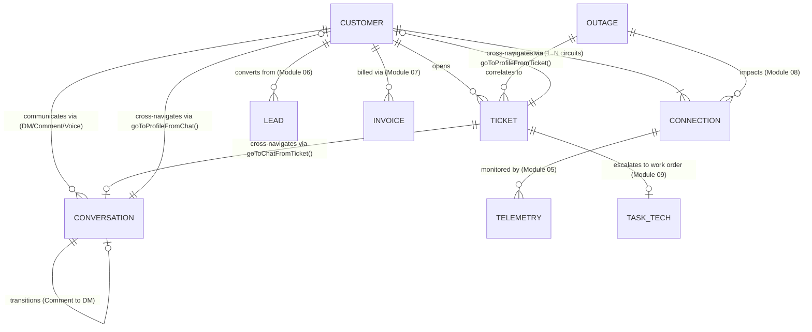

# SpaceNet AI CRM — Shared Data Contract & Architecture Standard

**Document Version:** 1.6.0
**Effective Date:** 2026-10-31
**Authors & Maintainers:** Rohan (Customer-Facing & Support Lead) & Adnan (Operations & Admin Lead)
**Repository:** `https://github.com/lEVI2889/spacenet`
**Current Phase:** Frontend-Only Interactive CRM Demonstration

---

## 1. Project Architecture & Runtime Profile

### 1.1 Pure Client-Side Demonstration Architecture
SpaceNet is an intelligent Customer Relationship Management (CRM) and Network Operations Center (NOC) demonstration platform for high-density internet service providers.

* **Stack:** Vanilla HTML5, Modern ECMAScript (ES6+), styled via Tailwind CSS (MD3-adapted token set).
* **Build System:** Bundled and validated using Vite (`vite build`, output to `dist/`).
* **Runtime State:** Single-page reactive state engine. All state collections reside in-memory within client JavaScript runtime memory (`index.html`).
* **Backend Status:** **No production backend or live network APIs exist.** All network telemetry, customer queries, AI copilot responses, social feeds, simulated voice notes, customer verification lookups, support tickets, 360° customer profiles, multi-connection toggles, and diagnostic results are simulated locally in the browser without external network calls or cloud dependencies.

### 1.2 Specification Version History

| Version | Date | Author | Core Additions & Scope |
| :--- | :--- | :--- | :--- |
| **v1.0.0** | 2026-10-30 | Rohan | Initial Shared Data Contract & Identifier Conventions (Module 01 Tasks 1–2). |
| **v1.1.0** | 2026-10-30 | Rohan | Omnichannel Expansion, Social Comments, Takeover & Private Notes (Module 01 Tasks 3–5). |
| **v1.2.0** | 2026-10-30 | Rohan | AI Conversational Intelligence, Multilingual Knowledge Base, Comment-to-DM, Voice Simulation (Module 02). |
| **v1.3.0** | 2026-10-31 | Rohan | Support Tickets & Customer Registry Contract, 7 Lifecycle States, Category Diagnostics, SLA Overdue, CSAT Ratings & Parallel Development Integration Hooks (Module 03). |
| **v1.4.0** | 2026-10-31 | Rohan | Customer Profiles & Unified 360° View: Multi-Connection Schema, Customer Record Extensions, Secondary Circuit Ticket Lifecycle, and Bi-Directional Cross-Navigation (Module 04). |
| **v1.5.0** | 2026-10-31 | Rohan | AI Troubleshooting & Diagnostics: DiagnosticSession Schema, Deterministic ISP Decision Trees, Simulated ONT/Router Telemetry, Speed Test Model, Cross-Module Diagnostics Integration (Ticket DIAGNOSTIC_EXEC sync, Customer 360 & Chat return), and Circuit Isolation (Module 05). |
| **v1.6.0** | 2026-11-01 | Adnan | Sales & Leads (Module 06): `SpaceNetLead` schema, `LEAD-<NUM>` implemented, coverage tri-state, team routing, idempotent AI lead capture from `sales_handoff` (Section 15). |

---

## 2. Identifier Conventions & Registry

To guarantee seamless navigation and referential integrity across modules developed by Rohan (Modules 01–05) and Adnan (Modules 06–10), all fixtures must adhere to the standardized prefix conventions.

### 2.1 Implemented & Standardized Identifiers (Active in Codebase)

| Entity | Canonical Format | UI Display Alias | Example | Implemented In |
| :--- | :--- | :--- | :--- | :--- |
| **Registered Customer** | `CUST-<ID>` | `#<ID>` | `CUST-8832` (`#8832`), `CUST-4410` (`#4410`) | Module 01 (Inbox), Module 03/04 (`SPACE_NET_CUSTOMERS`) |
| **Primary Circuit** | `SPN-<TYPE>-<ID>` | `SPN-<TYPE>-<ID>` | `SPN-FBR-0941`, `SPN-DED-4410` | Module 01 (Inbox), Module 03 (Tickets), Module 04 |
| **Secondary Circuit** | `SPN-<TYPE>-<ID>` | `SPN-<TYPE>-<ID>` | `SPN-FBR-0942`, `SPN-FBR-4412` | Module 04 (`customer.connections`) |
| **Conversation** | `CONV-<CHANNEL_KEY>-<ID>` | N/A | `CONV-WA-8832`, `CONV-FB-5120` | Module 01 (Tasks 1–5) |
| **Linked Private DM** | `CONV-<CHANNEL_KEY>-<ID>-DM` | N/A | `CONV-FB-5120-DM` | Module 02 (Feature Group 3) |
| **Support Ticket** | `TKT-<ID>` | `#TKT-<ID>` | `TKT-9042` (`#TKT-9042`) | Module 03 (Tickets Desk) |
| **Diagnostic Session** | `DIAG-<YYYYMMDD>-<NUM>` | N/A | `DIAG-20261031-001`, `DIAG-20261031-004` | Module 05 (`diagnosticSessions`) |
| **Sales Lead** | `LEAD-<NUM>` | `LEAD-<NUM>` | `LEAD-3001` | Module 06 (`leads`) |
| **Standard Message** | `m-<CUST_ABBR>-<NUM>` or `msg-<TIMESTAMP>` | N/A | `m-alx-1`, `msg-1730301234` | Module 01 (Tasks 1–5) |
| **Voice Note Message** | `vmsg-<CUST_ABBR>-<NUM>` | N/A | `vmsg-alx-1`, `vmsg-frh-1` | Module 02 (Feature Group 6) |
| **System Event Log** | `sys-<TIMESTAMP>` | N/A | `sys-1730302345` | Module 01 (Task 4) |
| **Transition Event Log** | `sys-trans-<TIMESTAMP>` | N/A | `sys-trans-1730304444` | Module 02 (Feature Group 3) |
| **Internal Staff Note** | `note-<TIMESTAMP>` | N/A | `note-1730303456` | Module 01 (Task 5) |

### 2.2 Existing but Not Standardized (Active in DOM / Statically Defined)

| Entity | Current Format in DOM | Planned Canonical Format | Notes |
| :--- | :--- | :--- | :--- |
| **Network Outages** | Static banner & modal text | `OUT-<ZONE>-<NUM>` (e.g. `OUT-DAC-0104`) | Module 08 (Network Outages / NOC) severity alert banners. |

### 2.3 Proposed Identifiers — Requires Adnan's Review & Agreement

| Entity | Proposed Format | Description | Target Module |
| :--- | :--- | :--- | :--- |
| **Invoice / Billing** | `INV-<NUM>` | Billing statement and charge record ID | Module 07 (Billing & Plans) |
| **Technician Task** | `TASK-TECH-<NUM>` | Field dispatch assignment ID | Module 09 (Technician & Field Operations) |
| **ONT Hardware MAC** | `00:E0:4C:<HEX>` | Physical hardware address identifier | Telemetry & Diagnostics |

---

## 3. Normalized Conversation Data Schema

Every conversation record in `conversations` conforms to the normalized schema below:

```javascript
{
  // Canonical Identifiers
  conversationId: 'CONV-FB-5120',             // Format: CONV-<CHANNEL>-<ID> (or ...-DM for linked DMs)
  customerId: 'CUST-5120',                     // Format: CUST-<ID>
  key: 'tanvir',                               // Legacy lookup key for backward compatibility
  displayId: '#5120',                          // UI display string

  // Customer Profile
  customerName: 'Tanvir Hossain',
  circuitId: 'SPN-FBR-5120',                   // Link to NOC circuit record
  plan: 'Fiber Home 150Mbps',                  // Plan description
  planBadge: 'Fiber Home 150M',                // Compact pill label
  planBadgeColor: 'text-primary',              // MD3 Tailwind color token

  // Channel & Classification
  channel: 'facebook',                        // Canonical key: 'facebook' | 'instagram' | 'whatsapp' | 'telegram' | 'web'
  channelLabel: 'Facebook',                   // User-facing channel label
  channelBadge: 'FB',                          // Compact 2-letter badge
  channelColor: 'bg-primary text-on-primary',  // Primary badge styling
  badgeColor: 'bg-primary-fixed text-on-primary-fixed', // Header badge styling
  type: 'comment',                             // Conversation type: 'dm' | 'comment'
  status: 'ai_handling',                       // Control state: 'ai_handling' | 'human_takeover'
  unread: false,

  // Metadata Tag
  tag: {
    label: 'Facebook Comment',
    icon: 'forum',                             // Google Material Symbol ligature
    bg: 'bg-primary-fixed text-on-primary-fixed font-semibold'
  },

  // Parent Social Post Context (Required when type === 'comment')
  postContext: {
    platform: 'Facebook',                      // 'Facebook' | 'Instagram'
    pageName: 'SpaceNet Broadband',
    postSnippet: 'Monsoon Fiber Upgrade Campaign: Free Wi-Fi 6 router upgrades...',
    postTime: '2 hours ago',
    permalink: 'https://facebook.com/spacenet/posts/98120341'
  },

  // Linked Private DM Context (Present when conversation is a linked private transition)
  originCommentId: 'CONV-FB-5120',             // Optional reference to originating public comment
  originPostSnippet: 'Monsoon Fiber Upgrade Campaign...', // Optional excerpt of parent post

  // Message Timeline (Polymorphic Message Array)
  lastMessageTime: 'Just now',
  messages: [
    // 1. Inbound Customer Message / Comment
    {
      id: 'm-tnv-1',
      sender: 'customer',                      // 'customer' | 'ai' | 'staff' | 'telemetry' | 'system' | 'note' | 'voice'
      text: 'Is Dhanmondi Road 27 covered under this Monsoon promotion?',
      time: '12:10 PM'
    },
    // 2. Outgoing Staff Message (under Human Takeover)
    {
      id: 'msg-1730301111',
      sender: 'staff',
      author: 'Rohan (Tier III NOC)',
      text: 'Yes Tanvir! Dhanmondi Road 27 is fully upgraded to our GPON ring.',
      time: '12:14 PM'
    },
    // 3. System Audit Event (takeover | handback | transition)
    {
      id: 'sys-trans-1730302222',
      sender: 'system',
      eventType: 'transition',                 // 'takeover' | 'handback' | 'transition'
      text: 'Privacy Transition: Thread transitioned from public comment on Facebook post to secure 1:1 Direct Message.',
      time: '12:12 PM'
    },
    // 4. Internal Private Note (Team Only)
    {
      id: 'note-1730303333',
      sender: 'note',
      isInternal: true,
      author: 'Rohan (Tier III NOC)',
      text: 'Verified customer circuit SPN-FBR-5120 on Dhanmondi OLT-04 port 2.',
      time: '12:15 PM'
    },
    // 5. Simulated Voice Note (Module 02)
    {
      id: 'vmsg-alx-1',
      sender: 'voice',
      customerInitials: 'AR',
      duration: '0:34',
      audioSource: 'WhatsApp Voice Note (44.1 kHz Opus)',
      language: 'English',                     // 'English' | 'বাংলা (Bangla)' | 'Banglish'
      transcript: 'Hey support, my 5GHz Wi-Fi network disappeared...',
      detectedIntent: 'Technical Troubleshooting (Wi-Fi Radio)',
      confidence: '97% Match',
      keyEntities: ['5GHz Band', 'Wi-Fi Radio', 'Dual-Band Router'],
      suggestedAction: 'Run 5GHz radio diagnostic & separate SSID bands',
      suggestedReply: 'I ran a remote sweep on your GPON ONT...',
      time: '10:45 AM'
    }
  ],

  // Suggested AI Quick Actions
  suggestions: [
    "Yes, Dhanmondi Road 27 is fully eligible for the free Wi-Fi 6 router upgrade.",
    "Would you like me to book our field tech for router swap this Thursday?"
  ]
}
```

---

## 4. Public Comment to Private DM Transition & Linked DM Contracts

### 4.1 Transition Flow & One-Click Invitation
When a customer inquires on a public social post (`type: 'comment'`), sharing sensitive personal data (e.g. phone number, installation address) publicly is discouraged.
1. The AI Copilot displays `#comment-to-dm-banner` with a recommendation to invite the subscriber to a private message.
2. Clicking `[Insert Public DM Invitation]` (`insertPublicDmInvite()`) populates an editable, language-tailored public comment in the composer.
3. Clicking `[Continue in Private DM]` (`continueInPrivateDm()`) transitions the workspace to a linked private conversation.

### 4.2 Idempotency & Duplicate Prevention
To prevent thread fragmentation during repeated transitions:
* The linked private thread adopts a predictable canonical ID: `${currentConv.conversationId}-DM` (e.g. `CONV-FB-5120-DM`).
* Lookup checks both `c.conversationId === targetDmConvId` and `c.originCommentId === currentConv.conversationId`.
* If a linked DM thread already exists, `continueInPrivateDm()` immediately navigates to it without duplicating entries in `conversations`.
* Private internal staff notes (`isInternal: true`) are strictly filtered out and never leaked into customer-visible threads during transition.

### 4.3 Transition Audit Event
Whenever a transition occurs, a permanent audit record is inserted into the linked private thread:
```javascript
{
  id: 'sys-trans-' + Date.now(),
  sender: 'system',
  eventType: 'transition',
  text: 'Privacy Transition: Thread transitioned from public comment on ' + (originConv.channelLabel || originConv.channel) + ' post to secure 1:1 Direct Message.',
  time: timeStr
}
```

---

## 5. Knowledge Base & Intent Classification Integration Contract (Module 02)

Module 02 introduces a deterministic, client-side conversational intelligence pipeline that classifies inquiries, extracts entities, and synthesizes structured multi-point answers.

### 5.1 Knowledge Base Categories (`SPACE_NET_KNOWLEDGE_BASE`)
The knowledge base comprises 9 structured ISP topics:
1. `packages_pricing`: Residential & business bandwidth packages, speed tiers, monthly pricing.
2. `coverage_availability`: Service coverage across Dhaka metropolitan zones.
3. `installation_procedure`: Deployment fees, standard setup timelines, free installation thresholds.
4. `billing_guidance`: Payment methods (bKash, Nagad, bank transfers), billing cycles, invoice download guidance.
5. `package_changes`: Upgrades (instant, free) and downgrades (effective next billing cycle).
6. `service_policies_sla`: Uptime SLAs (99.9% residential, 99.99% enterprise) and outage service-credit compensation.
7. `support_hours`: 24/7/365 NOC availability and daily field dispatch hours (8:00 AM – 10:00 PM).
8. `technical_problem`: Optical power sweep, PON/LOS indicator troubleshooting, ONT reboot sequence.
9. `human_escalation`: Explicit escalation request acknowledgment for Tier III NOC engineering.

### 5.2 Intent Classification Contract (`classifyCustomerIntent`)
Every customer inquiry is processed by `classifyCustomerIntent(text, preferredLang)`, returning a standardized classification payload:
```typescript
interface IntentClassificationResult {
  intent: string;                              // e.g. "packages_pricing" | "coverage_availability" | "technical_problem"
  confidence: number;                          // Decimal score (0.00 – 0.99)
  route: 'ticket_suggest' | 'sales_handoff' | 'billing_guidance' | 'faq' | 'human_escalation';
  isMultiIntent: boolean;                      // True when >= 2 distinct strong intents are detected
  intents: string[];                           // Array of matched category keys
  entities: {
    packages: string[];                        // Extracted packages (e.g. ["Fiber Gamer 300Mbps"])
    coverageZones: string[];                   // Extracted zones (e.g. ["Banani"])
  };
  response: string;                            // Synthesized language-specific response text
}
```

### 5.3 Multi-Intent Recognition & 3-Point Response Synthesis
* **Compound Recognition:** If an inquiry contains up to 3 distinct intents with strong independent keyword matches (e.g. *"How much is the installation fee for Fiber Gamer 300M, and is it available in Banani?"*), `classifyCustomerIntent` detects all three: `packages_pricing`, `installation_procedure`, and `coverage_availability`.
* **Structured Synthesis:** Generates a clean, numbered multi-point response (`1. [Price]`, `2. [Installation]`, `3. [Coverage]`) formatted in the active language mode.
* **Targeted Entity Responses:** If a specific package is named (e.g. *Fiber Gamer 300M*), the system outputs that specific tier (2,500 BDT/mo) and free installation qualification rather than dumping the entire 6-package catalog.

### 5.4 Multilingual Support & Unicode Normalization
* Supported Language Modes: English (`EN`), বাংলা (`BN`), and Banglish (Romanized Bengali).
* Script Priority: Explicit selection via `#chat-ai-lang-selector` takes priority over automatic script detection.
* Bengali Script Normalization: Keyword tokenization applies Unicode Category `\p{M}` (combining vowel marks, hasants, and nuktas) alongside `\p{L}` (`/[^\p{L}\p{M}\p{N}\s]/gu`) to prevent Bengali characters from splitting into disconnected glyphs.

### 5.5 Customer Frustration Detection
* Rule-based scanner (`detectCustomerFrustration`) identifies dissatisfaction keywords ("still not working", "3rd time", "worst service", "কাজ করছে না", "biroktikor").
* Displays `#chat-frustration-alert` with an immediate `[Escalate to Human NOC]` action button.
* Frustration UI is strictly decoupled from intent classification; historical frustration does not overwrite the current inquiry's detected topic.

---

## 6. Support Tickets & Customer Registry Contract (Module 03)

Module 03 establishes the formal Support Desk architecture, connecting customer conversations and technical diagnostics with unified ticketing, verification, guided troubleshooting, and lifecycle management.

### 6.1 Shared Subscriber Registry (`SPACE_NET_CUSTOMERS`)
The canonical in-memory subscriber registry provides verified customer records across all modules:
```typescript
interface SpaceNetCustomer {
  // Canonical Identifiers
  customerId: string;                         // Canonical ID (e.g. 'CUST-8832')
  displayId: string;                          // UI Display Alias (e.g. '#8832')
  name: string;                               // Full subscriber or corporate entity name
  phone: string;                              // Phone number (e.g. '+880 1711-098832')
  email: string;                              // Contact email address
  circuitId: string;                          // Primary active circuit reference (e.g. 'SPN-FBR-0941')
  plan: string;                               // Subscribed bandwidth plan (e.g. 'Fiber 500M')
  connectionType: string;                     // Connection technology (e.g. 'Fiber 1Gbps', 'Dedicated Leased Line')
  address: string;                            // Service installation address
  zone: string;                               // Service zone (e.g. 'Dhanmondi', 'Gulshan', 'Banani')
  activeConversationId: string | null;        // Originating conversation thread link if present

  // Module 04 Profile & Multi-Connection Extensions
  accountStatus: string;                      // e.g. 'Active (Good Standing)', 'VIP Corporate Account', 'Active (Outage Affected)'
  billingCycle: string;                       // e.g. '1st of each month', '15th of each month'
  registeredDate: string;                     // ISO date string (e.g. '2024-03-15')
  connections: Array<SpaceNetConnection>;     // Structured physical connections collection (>= 1 connection)
}
```

* **Customer Verification Helper (`verifyCustomer(query)`):**
  Accepts query string matching customer ID (`CUST-8832`), display ID (`#8832`), partial/full name (`Alex Rivera`), phone digits (`01711098832`), primary circuit ID (`SPN-FBR-0941`), secondary circuit ID (`SPN-FBR-0942`), or service area (`Dhanmondi`). Returns `{ verified: true, customer, matchedCircuitId }` or `{ verified: false, error }`.
* **Fictional Verification Fallback:** Unregistered lookups are rejected with explicit guidance: *"Customer record not found. Fictional verification fallback: Please verify customer phone or ID, or select from registered subscribers."*

### 6.2 Canonical Support Ticket Schema (`SpaceNetTicket`)
Every ticket in `tickets` adheres strictly to the normalized structure below:
```typescript
interface SpaceNetTicket {
  // Canonical Identifiers
  ticketId: string;                           // Format: 'TKT-<NUM>' (e.g. 'TKT-9042')
  displayId: string;                          // Format: '#TKT-<NUM>' (e.g. '#TKT-9042')
  customerId: string;                         // Format: 'CUST-<ID>' (e.g. 'CUST-8832')
  customerName: string;                       // e.g. 'Alex Rivera'
  circuitId: string;                          // Format: 'SPN-<TYPE>-<ID>' (Target Service Circuit, e.g. 'SPN-FBR-0941' or 'SPN-FBR-0942')
  connectionType: string;                     // e.g. 'Fiber 1Gbps', 'Fiber Home Office 100M', 'Dedicated Leased Line'

  // Categorization & Priority
  category: 'NO_INTERNET' | 'SLOW_INTERNET' | 'ROUTER_WIFI' | 'BILLING' | 'GENERAL';
  categoryLabel: string;                      // Display label (e.g. 'No Internet', 'Slow Speed')
  priority: 'NORMAL' | 'HIGH' | 'URGENT';

  // Lifecycle State
  status: 'OPEN' | 'IN_PROGRESS' | 'PENDING_CUSTOMER' | 'ESCALATED' | 'RESOLVED' | 'CLOSED' | 'REOPENED';
  statusLabel: string;                        // e.g. 'Open', 'Investigating', 'Awaiting Customer', 'Resolved', 'Closed', 'Reopened'

  // Issue Content
  subject: string;                            // Short incident headline
  description: string;                        // Technical symptom description
  handlingAgent: string;                      // e.g. 'AI Copilot' | 'Tier III NOC Engineering' | 'Agent: Rachel P.'
  assignedStaff: string;                      // Assigned internal technician or engineer

  // Omnichannel Chat Linkage
  relatedConversationId: string | null;       // Link to originating conversation (e.g. 'CONV-WA-8832')
  sourceChannel: string;                      // e.g. 'whatsapp' | 'facebook' | 'web' | 'portal' | 'desk'

  // SLA & Timestamps
  createdAt: string;                          // ISO 8601 creation timestamp
  updatedAt: string;                          // ISO 8601 last modified timestamp
  slaDueHours: number;                        // SLA target duration: 4 (Urgent), 8 (High), 24 (Normal)
  resolvedAt: string | null;                  // ISO 8601 timestamp when marked RESOLVED
  closedAt: string | null;                    // ISO 8601 timestamp when confirmed CLOSED
  reopenedAt: string | null;                  // ISO 8601 timestamp when REOPENED

  // Guided Troubleshooting Steps
  guidedSteps: Array<{
    id: string;                               // Step identifier (e.g. 'step-1')
    label: string;                            // Technical verification instruction
    completed: boolean;                       // Completion status
    completedAt: string | null;               // Completion timestamp / relative label
  }>;

  // Resolution & Customer Feedback
  resolutionSummary: string | null;           // Remediation notes and verification proof
  feedback: {
    rating: number;                           // 1 - 5 star score
    comment: string;                          // Customer review text
    submittedAt: string;                      // Submission ISO 8601 timestamp
  } | null;

  // Chronological Audit Log
  history: Array<{
    timestamp: string;                        // ISO 8601 timestamp
    timeStr: string;                          // Human-readable relative string
    author: string;                           // Action initiator
    action: 'CREATED' | 'STATUS_CHANGE' | 'ESCALATED' | 'RESOLVED' | 'CLOSED' | 'REOPENED' | 'DIAGNOSTICS_RUN' | 'DIAGNOSTIC_EXEC' | 'GUIDANCE_STEP' | 'FEEDBACK_RECEIVED' | 'VIEWED';
    notes: string;                            // Action description / system note
  }>;
}
```

### 6.3 Standard Categories, Priorities & SLA Rules
* **Issue Categories (`TICKET_CATEGORIES`):**
  1. `NO_INTERNET`: Default recommended priority `URGENT` (4-hour SLA window).
  2. `SLOW_INTERNET`: Default recommended priority `HIGH` (8-hour SLA window).
  3. `ROUTER_WIFI`: Default recommended priority `NORMAL` (24-hour SLA window).
  4. `BILLING`: Default recommended priority `NORMAL` (24-hour SLA window).
  5. `GENERAL`: Default recommended priority `NORMAL` (24-hour SLA window).
* **Priorities (`TICKET_PRIORITIES`):**
  - `URGENT`: 4h target, error pulsating indicator.
  - `HIGH`: 8h target, amber warning indicator.
  - `NORMAL`: 24h target, standard indicator.
* **Auto-Recommendation:** Selecting or changing a category auto-populates the recommended priority, while allowing manual staff override.

### 6.4 Validated Lifecycle State Machine
```
 [ OPEN ] ───────► [ IN_PROGRESS ] ───────► [ PENDING_CUSTOMER ]
     │                    │                          │
     │                    ▼                          ▼
     └───────────────► [ ESCALATED ] ────────► [ RESOLVED ] ──────► [ CLOSED ]
                                                     ▲                 │
                                                     └─ [ REOPENED ] ◄─┘
```
* **Validation Guards:**
  - Transition directly to `CLOSED` is strictly prohibited unless `status === 'RESOLVED'`.
  - Transition to `REOPENED` is strictly prohibited unless previous status was `RESOLVED` or `CLOSED`.
  - Re-transitioning to the current status returns `{ success: false, error }`.
  - Every valid transition updates `updatedAt`, sets the corresponding timestamp (`resolvedAt`, `closedAt`, or `reopenedAt`), and appends a timestamped audit entry to `history`.

### 6.5 Category Guided Support & Simulated Hardware Diagnostics
* **Checklists (`getGuidedStepsForCategory`):** Dynamically provides 4 technical troubleshooting steps tailored to the issue category. Staff can check off items (`toggleGuidedStep`), updating step completion and logging audit events.
* **Simulated Diagnostic Triggers (`runSimulatedDiagnostic`):**
  - Remote ONT Reboot: Dispatches simulated signal, confirms ONT renegotiation in 14.2s.
  - Optical Power Sweep: Evaluates GPON Rx dBm (nominal range -8 dBm to -27 dBm, returns -19.4 dBm).
  - Throughput Speed Test: Confirms line speed (942 Mbps down / 918 Mbps up, 3ms core latency).
* **Sync to Resolution (`syncGuidedStepsToResolution`):** Compiles all completed troubleshooting checklist items into a structured resolution summary for one-click documentation.

### 6.6 Chat Integration & Copilot Actionable Prefill
* **Actionable "Suggest Ticket":** When Module 02 Copilot detects a technical problem, clicking `"Suggest Ticket"` (`handleRoutingAction`) opens `#create-ticket-modal` with prefilled subscriber details:
  - `customerId`: e.g. `CUST-8832`
  - `customerName`: e.g. `Alex Rivera`
  - `circuitId`: e.g. `SPN-FBR-0941`
  - `conversationId`: e.g. `CONV-WA-8832`
  - `sourceChannel`: e.g. `whatsapp`
  - `subject` & `description`: derived from latest customer inquiry.
* **Explicit Creation Confirmation:** Pre-filling does not write to in-memory state until staff explicitly confirms creation via `submitCreateTicket()`.
* **Bi-Directional Navigation (`goToChatFromTicket`):** Ticket detail view provides an `[Open Chat]` button that auto-resets inbox filters to `'all'`, switches to Unified Inbox, and selects the exact customer conversation thread.

### 6.7 Duplicate Detection & SLA Overdue Tracking
* **Duplicate Incident Detection (`checkDuplicateTicket`):** Circuit-aware duplicate detection. Identifies if a customer already has an active ticket in the same category for the specified circuit (or any circuit if unspecified) in unresolved states (`OPEN`, `IN_PROGRESS`, `PENDING_CUSTOMER`, `ESCALATED`, `REOPENED`). Displays an alert modal offering `[View Existing Ticket]` or `[Proceed as New Incident]`.
* **SLA Overdue Tracking (`isTicketOverdue`):** Compares `(Date.now() - createdAt)` against `slaDueHours * 3600 * 1000`. Overdue tickets display an animated `⚠️ OVERDUE by X hrs` badge. Tickets in `RESOLVED` or `CLOSED` state are excluded.
* **Simulated Customer Status Inquiry (`simulateCustomerStatusInquiry`):** Supports looking up status by Ticket ID or Customer ID, returning structured customer, state, assigned agent, and SLA timing information.

### 6.8 Resolution, Reopening & CSAT Ratings
* **Resolution Documentation:** Captures resolution summary, sets status to `RESOLVED`, records `resolvedAt`.
* **Simulated Customer Confirmation & Closure:** Allows simulating subscriber confirmation of restored service to transition tickets to `CLOSED` and record `closedAt`.
* **Reopening:** If an issue recurs, staff can transition status to `REOPENED` while preserving all prior resolution summaries, customer ratings, and complete audit history.
* **CSAT Rating:** 1–5 star rating simulator with optional feedback comment. Renders star ratings (`★★★★★`) and feedback in the ticket workspace.

---

## 7. Customer Profiles & Unified Customer 360° View Contract (Module 04)

Module 04 establishes the consolidated Customer 360° workspace, providing multi-circuit management, omnichannel interaction timelines, ticket history aggregation, and cross-navigation.

### 7.1 Connection Schema (`SpaceNetConnection`)
Each physical connection associated with a subscriber conforms to the normalized schema below:
```typescript
interface SpaceNetConnection {
  circuitId: string;                           // Format: 'SPN-<TYPE>-<ID>' (e.g. 'SPN-FBR-0941', 'SPN-FBR-0942')
  plan: string;                                // e.g. 'Fiber 500M', 'Fiber Home Office 100M'
  connectionType: string;                      // e.g. 'Fiber 1Gbps', 'Fiber GPON', 'Dedicated Leased Line'
  address: string;                             // Installation address for this specific physical circuit
  zone: string;                                // Coverage zone (e.g. 'Dhanmondi', 'Gulshan', 'Tejgaon')
  connectionStatus: string;                    // 'Active (Online)' | 'Degraded (Optical Loss Alert)' | 'Standby' | 'Offline'
  isPrimary: boolean;                          // Flag distinguishing primary account circuit vs secondary/backup
  equipment: {
    ontModel: string;                          // Hardware ONT model (e.g. 'Huawei EchoLife HG8245H5 GPON ONT')
    routerModel: string;                       // Wi-Fi router model (e.g. 'TP-Link Archer AX73 (Wi-Fi 6 Dual-Band)')
    oltPort: string;                           // Upstream distribution switch / OLT port
    opticalRx: string;                         // Current optical receive level (e.g. '-19.2 dBm (Nominal)')
    pingLatency: string;                       // Core gateway latency (e.g. '11.4 ms')
    ipAddress: string;                         // Assigned IP address (static public or CGNAT)
    macAddress: string;                        // Physical hardware MAC address
  };
  installedDate: string;                       // Circuit provisioning date (ISO format)
}
```

### 7.2 Primary and Secondary Circuit Compatibility Contract
1. **Primary Circuit Immutability:** `customer.circuitId` strictly preserves the subscriber's primary circuit identifier. Existing Module 01 and 02 fixtures and lookups relying on `cust.circuitId` remain 100% backward-compatible.
2. **Multiple Connections Support:** `customer.connections` holds an array of one or more physical circuits.
   - **Alex Rivera (`CUST-8832`):** Primary `SPN-FBR-0941` (Fiber 500M) + Secondary `SPN-FBR-0942` (Fiber Home Office 100M).
   - **Vanguard Logistics (`CUST-4410`):** Primary `SPN-DED-4410` (Dedicated Leased Line 1G) + Secondary `SPN-FBR-4412` (Redundant GPON Failover 200M).
3. **State Isolation:** Switching inspected connections via `selectCustomerConnection(circuitId)` updates client UI telemetry and hardware cards but **does not modify** the primary `customer.circuitId`.
4. **Targeted Ticket Association:** Support tickets record the specific affected line in `ticket.circuitId`.

### 7.3 Circuit-Aware Ticket Creation & Verification Contract
* **Interactive Modal Prefill (`selectCustomerForTicket(customerId, targetCircuitId)`):**
  When creating a ticket from the Customer 360° workspace (`createTicketFromProfile`):
  - Formally identifies `Primary Customer Circuit: SPN-FBR-0941` in `#new-ticket-primary-circuit-val`.
  - Prominently highlights `Selected Service Circuit: SPN-FBR-0942` in `#new-ticket-selected-circuit-badge`.
  - Provides quick-switch buttons for multi-connection accounts to toggle target lines before submission.
* **Persisted Storage:** `submitCreateTicket()` guarantees that the submitted ticket object explicitly stores `circuitId: chosenCircuit` and the matching connection package.
* **Ticket Detail Workspace (`populateTicketModalUI`):**
  - Displays **Affected Service Circuit** in `#td-modal-circuit`.
  - Displays **Primary Customer Circuit** in `#td-modal-primary-circuit`.
  - Displays circuit-specific package tier in `#td-modal-plan`.
* **Circuit-Scoped Duplicate Detection:** `checkDuplicateTicket(customerId, categoryKey, circuitId)` ensures that an active ticket on a primary circuit does not falsely block creating an incident for a separate secondary connection.

### 7.4 Bi-Directional Cross-Navigation Integration Points

| Navigation Direction | Trigger Element | Function Invoked | Behavior |
| :--- | :--- | :--- | :--- |
| **Profile &rarr; Inbox** | `[Open in Inbox]` in `#cust-conversations-card` | `goToChatFromProfile(convId)` | Resets inbox filters to `'all'`, switches to `#view-unified-inbox`, selects customer conversation. |
| **Inbox &rarr; Profile** | `[360° Profile]` in `#chat-customer-profile-btn` | `goToProfileFromChat(customerId)` | Resolves active customer from conversation, switches to `#customer-profiles`, selects subscriber card. |
| **Profile &rarr; Ticket** | `[View Ticket]` in `#cust-tickets-card` | `openTicketDetailFromProfile(ticketId)` | Opens `#ticket-detail-modal` for the selected incident. |
| **Ticket &rarr; Profile** | `[360° View]` in `#td-modal-profile-btn` | `goToProfileFromTicket(customerId)` | Closes ticket modal, switches to `#customer-profiles`, selects subscriber card. |
| **Profile &rarr; Create Ticket** | `[Create Ticket]` in `#cust-360-hero-card` | `createTicketFromProfile(customerId)` | Opens `#create-ticket-modal` prefilled with customer ID, name, and currently selected circuit. |

### 7.5 Structural Boundary Specification
To avoid integration ambiguity across team members:
1. **Implemented Stable Fields:** In-memory properties on `SPACE_NET_CUSTOMERS` (`customerId`, `circuitId`, `connections`, `accountStatus`, `billingCycle`, `registeredDate`) and `tickets` (`ticketId`, `circuitId`, `customerId`).
2. **Internal Implementation Details:** DOM IDs (`#customer-directory-list`, `#cust-connection-tabs`, `#cust-360-hero-card`), Tailwind layout classes, and toast feedback.
3. **Future Proposed Integration Hooks (Adnan's Modules 06–10):**
   - **Module 06 (Sales & Leads):** Lead conversion linking prospective clients to canonical customer profiles via `customerId`.
   - **Module 07 (Billing & Plans):** Invoice binding (`INV-<NUM>`) referencing `customer.billingCycle` and `customer.accountStatus`.
   - **Module 08 (Network Outages / NOC):** Outage incident impact mapping using `conn.circuitId`, `conn.zone`, and `conn.equipment.oltPort`.
   - **Module 09 (Technician & Field Operations):** Field dispatch work orders targeting specific physical hardware (`conn.equipment.ontModel`, `routerModel`, `macAddress`).
   - **Module 10 (Admin & Analytics):** Bandwidth aggregation and subscriber distribution across coverage zones.

---

## 8. AI Troubleshooting & Diagnostics Contract (Module 05)

Module 05 introduces an interactive, pure client-side diagnostic workbench and deterministic guided decision-tree engine for SpaceNet AI CRM.

### 8.1 Pure Client-Side Demonstration Architecture & Hardware Safety
* **Zero Backend & No Real Hardware Probing:** All troubleshooting workflows, GPON optical attenuation sweeps, WAN gateway pings, Wi-Fi channel contention scans, remote router reboots, and speed-test benchmarks execute in-memory inside client JavaScript runtime (`index.html`).
* **Hardware Credential Protection:** The application never requests live router passwords, never establishes Telnet/SSH/SNMP sessions, and never communicates with physical customer-premises equipment (CPE) or public speed test servers.
* **Demonstration Warnings:** All diagnostic views display explicit `SIMULATED TELEMETRY` and demonstration disclaimer badges.

### 8.2 Canonical Diagnostic Session Schema (`DiagnosticSession`)

Every completed or active diagnostic run is recorded in `diagnosticSessions` adhering to the following structure:

```typescript
interface DiagnosticSession {
  sessionId: string;                          // Format: DIAG-<YYYYMMDD>-<NUM> (e.g. 'DIAG-20261031-001')
  customerId: string;                         // Canonical ID (e.g. 'CUST-8832')
  customerName: string;                       // e.g. 'Alex Rivera'
  circuitId: string;                          // Specific service line (e.g. 'SPN-FBR-0941' or 'SPN-FBR-0942')
  circuitPlan: string;                        // Subscribed plan (e.g. 'Fiber 500M')
  isPrimaryCircuit: boolean;                  // Flag distinguishing primary vs secondary connection
  diagnosticType: 'NO_INTERNET' | 'SLOW_INTERNET' | 'ROUTER_WIFI' | 'SPEED_TEST' | 'OPTICAL_SWEEP' | 'ONT_REBOOT' | 'WIFI_SCAN' | 'WAN_CHECK' | 'ONT_STATUS';
  status: 'IN_PROGRESS' | 'COMPLETED' | 'ESCALATED' | 'RESOLVED';
  severity: 'Healthy' | 'Degraded' | 'Critical' | 'Needs Human Review' | 'Resolved';
  stageIndex: number;
  stageName: string;
  responses: Array<{
    questionId: string;
    question: string;
    answerKey: string;
    answerLabel: string;
    timestamp?: string;                       // ISO 8601
  }>;
  telemetry: {
    routerPower?: 'ON' | 'OFF';
    ontPower?: 'ON' | 'OFF';
    ponStatus?: 'Solid Green' | 'Blinking Green' | 'Off';
    losWarning?: 'Normal (No Loss)' | 'Red Alert (Loss of Light)' | 'None';
    opticalRx?: string;                       // e.g. '-27.4 dBm (High Attenuation Warning)'
    opticalRxStatus?: 'Optimal' | 'Nominal' | 'Degraded' | 'Critical';
    latency?: string;                         // e.g. '11.4 ms'
    jitter?: string;                          // e.g. '1.8 ms'
    packetLoss?: string;                      // e.g. '0.0%'
    downloadSpeed?: string;                   // e.g. '482 Mbps'
    uploadSpeed?: string;                     // e.g. '468 Mbps'
    rebootTimeSec?: number;                   // e.g. 14.2
    wifi24Channel?: number;                   // e.g. 6
    wifi5Channel?: number;                    // e.g. 36
    ipAddress?: string;                       // e.g. '103.24.110.42 (Dynamic CGNAT)'
    macAddress?: string;                      // e.g. '00:E0:4C:88:32:01'
    oltPort?: string;                         // e.g. 'Dhanmondi OLT-04 Port 2 (GPON Slot 3)'
  };
  recommendations: string[];
  nextAction: string;
  outcome: 'Healthy' | 'Degraded' | 'Critical' | 'Needs Human Review' | 'Resolved';
  timestamp: string;                          // ISO 8601
  timeStr: string;                            // e.g. 'Just now'
  ticketId?: string | null;                   // Linked support incident (e.g. 'TKT-9042')
  conversationId?: string | null;             // Linked omnichannel chat (e.g. 'CONV-WA-8832')
}
```

### 8.3 Guided Troubleshooting Workflows (`SPACE_NET_DIAGNOSTIC_WORKFLOWS`)

Three deterministic decision trees guide technical support agents through common ISP issues:

1. **`NO_INTERNET` (5 Stages):**
   - Stage 1: Power & Equipment State (`pwr_check`) &rarr; Checks AC adapters and LED illumination.
   - Stage 2: GPON PON Indicator Status (`pon_check`) &rarr; Evaluates solid lock, ranging blink, or dark state.
   - Stage 3: Optical LOS Alarm (`los_check`) &rarr; Evaluates fiber drop cut red alarm (< -30 dBm).
   - Stage 4: Client Device Outage Scope (`device_scope`) &rarr; Isolates single-device Wi-Fi DHCP vs whole-premise loss.
   - Stage 5: Remote Reboot & WAN Renewal (`reboot_verify`) &rarr; Verifies renegotiation or initiates ticket escalation.
2. **`SLOW_INTERNET` (4 Stages):**
   - Stage 1: Transmission Medium (`medium_check`) &rarr; Wi-Fi vs Gigabit Ethernet Cat6.
   - Stage 2: Wi-Fi Band & Interference (`band_check`) &rarr; 2.4 GHz congestion vs 5 GHz migration.
   - Stage 3: Local Network Contention (`contention_check`) &rarr; Concurrent 4K streaming, torrents, cloud sync.
   - Stage 4: Speed Test Verification (`speed_test_step`) &rarr; Benchmark against provisioned plan tier.
3. **`ROUTER_WIFI` (4 Stages):**
   - Stage 1: SSID Visibility (`ssid_check`) &rarr; Radio disabled vs firmware freeze.
   - Stage 2: WPA Authentication (`auth_check`) &rarr; Passkey mismatch vs signal drop.
   - Stage 3: Signal Coverage & Attenuation (`signal_check`) &rarr; Structural wall loss vs repeater requirement.
   - Stage 4: RF Channel Optimization (`channel_opt`) &rarr; 5 GHz 80MHz channel shift.

### 8.4 Simulated Hardware Telemetry Operations

| Diagnostic Tool | Signature | Simulated Execution Behavior | Output Telemetry |
| :--- | :--- | :--- | :--- |
| **ONT Status Check** | `simulateOntStatusCheck(custId?, circuitId?)` | Inspects ONT hardware, PON lock, optical Rx, and IP lease. Defaults to active workbench target. | Hardware models, MAC, OLT port, Rx power, packet loss, CGNAT IP. |
| **Remote ONT/Router Reboot** | `simulateRouterReboot(custId?, circuitId?)` | Dispatches remote power-cycle signal, renegotiates GPON link in 14.2s, renews DHCP WAN lease. | `rebootTimeSec: 14.2`, `ponStatus: 'Solid Green'`, `outcome: 'Resolved'`. |
| **Optical Power Sweep** | `simulateOpticalPowerSweep(custId?, circuitId?)` | Evaluates receive levels against standard ISP thresholds (-8 to -22 dBm Optimal, -27.4 dBm Degraded, < -30 dBm Critical). | `opticalRx`, `opticalRxStatus`, attenuation alerts. |
| **WAN Connectivity Ping** | `simulateWanConnectivityCheck(custId?, circuitId?)` | Pings core gateway, resolves SpaceNet Core DNS (1.8 ms), measures latency and packet loss. | `latency`, `packetLoss`, SpaceNet Core DNS resolution time. |
| **Wi-Fi Channel Inspection** | `simulateWifiChannelInspection(custId?, circuitId?)` | Evaluates 2.4 GHz Channel 6 (78% contention) vs 5 GHz Channel 36 (clean 80MHz spectrum). | `wifi24Channel: 6`, `wifi5Channel: 36`, recommendation to migrate. |
| **Simulated Speed Test** | `startSimulatedSpeedTest(custId?, circuitId?)` | Simulates throughput proportional to active circuit plan tier with realistic latency and jitter. | `downloadSpeed`, `uploadSpeed`, `latency`, `jitter`, `packetLoss`. |

### 8.5 Connection-Aware Targeting & Isolation Model
* **Multi-Circuit Subscriber Support:** Supports independent testing of primary and secondary circuits for multi-connection subscribers (e.g. Alex Rivera `CUST-8832` primary `SPN-FBR-0941` vs secondary `SPN-FBR-0942`; Vanguard Logistics `CUST-4410` primary `SPN-DED-4410` vs secondary `SPN-FBR-4412`).
* **Primary Circuit Immutability:** Selecting or diagnosing a secondary circuit dynamically targets the diagnostic workbench (`currentDiagCircuitId`), but **strictly preserves** `customer.circuitId` in `SPACE_NET_CUSTOMERS`.
* **Telemetry Isolation:** Secondary circuit `SPN-FBR-0942` evaluates healthy optical power (-16.8 dBm) and 98 Mbps throughput, completely isolated from primary circuit `SPN-FBR-0941` (-27.4 dBm degraded attenuation).

### 8.6 Cross-Module Integration Hooks

| Integration Point | Source Module & Control | Implementation Detail | Behavior |
| :--- | :--- | :--- | :--- |
| **Customer 360° &rarr; Diagnostics** | Module 04 Hero Card `[AI Diagnostics]` | `openDiagnosticsFromProfile(customerId, circuitId)` | Opens `#view-ai-diagnostics`, targets customer & circuit, records origin context for back navigation. |
| **Diagnostics &rarr; Customer 360°** | Module 05 `[Back to 360° Profile]` | `returnFromDiagnostics()` | Restores `#view-customer-profiles` with active customer pre-selected. |
| **Support Ticket &rarr; Diagnostics** | Module 03 Modal `[Full AI Diagnostics]` | `openDiagnosticsFromTicket(ticketId)` | Opens diagnostics, maps ticket category to diagnostic workflow, preserves `ticketId`. |
| **Diagnostics &rarr; Support Ticket** | Module 05 `[Back to Ticket]` | `returnFromDiagnostics()` | Restores `#view-tickets` and re-opens ticket detail modal. |
| **Sync Diagnostic to Ticket** | Module 05 `[Sync to Ticket]` | `syncDiagnosticToLinkedTicket(ticketId, session)` | Appends audit event `action: 'DIAGNOSTIC_EXEC'` to `ticket.history` with tested circuit telemetry. |
| **Escalate to New Ticket** | Module 05 `[Escalate to Support Ticket]` | `escalateDiagnosticToTicket(session)` | Opens `#create-ticket-modal` prefilled with tested customer, circuit, category, priority, and diagnostic findings. Requires explicit staff confirmation. |
| **Unified Inbox &rarr; Diagnostics** | Module 01/02 Chat Header Copilot | `openDiagnosticsFromChat(conversationId)` | Opens diagnostics targeting customer linked to chat. |
| **Diagnostics &rarr; Unified Inbox** | Module 05 `[Back to Unified Inbox]` | `returnFromDiagnostics()` | Restores `#view-unified-inbox` with thread preserved. |
| **Human Takeover Safety** | Module 01/02 Safety Guard | `conv.status === 'human_takeover'` | Diagnostic results are never automatically sent as customer-facing messages when takeover is active. |

### 8.7 History Storage & Non-Destructive Reset
* **History Storage:** All sessions are recorded in `diagnosticSessions`. Filterable by active circuit (`filterDiagHistoryByCircuit('active')`) or all records (`filterDiagHistoryByCircuit('all')`).
* **Non-Destructive Demo Reset (`resetDiagnosticsDemoState()`):** Restores `diagnosticSessions` to baseline fixtures (`DEFAULT_DIAGNOSTIC_SESSIONS`) without deleting tickets, customer profiles, or conversations.

### 8.8 Global Window Bindings & Public API
All diagnostic functions and states are synchronized to `window` for reliable cross-browser execution:
* `window.currentDiagCustomerId`, `window.currentDiagCircuitId`, `window.diagnosticSessions`
* `window.selectDiagCustomer`, `window.selectDiagCircuit`, `window.switchDiagWorkflow`
* `window.simulateOntStatusCheck`, `window.simulateRouterReboot`, `window.simulateOpticalPowerSweep`
* `window.simulateWanConnectivityCheck`, `window.simulateWifiChannelInspection`, `window.startSimulatedSpeedTest`
* `window.openDiagnosticsFromProfile`, `window.openDiagnosticsFromTicket`, `window.openDiagnosticsFromChat`
* `window.syncDiagnosticToLinkedTicket`, `window.escalateDiagnosticToTicket`, `window.resetDiagnosticsDemoState`

---

## 9. Customer Message Simulator (`#demo-customer-simulator-strip`)

To facilitate evaluation and QA testing without live messaging networks, Module 02 provides an interactive simulation toolbar:
* **UI Location:** Rendered directly above `#chat-message-stream`.
* **Controls:** Quick preset dropdown with 6 realistic test scenarios, custom message input, and `[Simulate]` trigger.
* **Execution:** Calls `executeSimulateCustomerMessage()`, injecting the message as `sender: 'customer'`.
* **Safety Boundaries:**
  * Strictly checks `conv.status === 'human_takeover'`. When takeover is active, incoming simulated messages are logged without triggering automated AI responses.
  * Message injection is isolated strictly to the active conversation thread.
  * Operates 100% in-memory; issues no network requests to external social platforms.

---

## 10. Demo-Only Commercial & Technical Safeguards

> [!IMPORTANT]
> **Fictional Data & Demonstration Boundaries:**
> 1. **Financial Safeguards:** All payment accounts displayed in billing responses explicitly carry prominent demo warnings: `bKash Merchant: 01700-000000 (DEMO-SIMULATION ONLY — Use Customer ID as reference)`. Reviewers and users must not transfer real funds.
> 2. **Commercial Pricing & Coverage:** Speed tiers, pricing (e.g. 2,500 BDT/mo), installation discounts, and coverage availability are simulated fixtures and do not represent legally binding SpaceNet business commitments.
> 3. **AI Determinism:** Conversational AI capabilities are executed using deterministic local rules and knowledge maps. No external LLM APIs (OpenAI, Gemini, Anthropic) or live network tokens are used.
> 4. **Voice Transcription Simulation:** Voice messages are simulated with pre-rendered waveform graphics and mock transcript records. No microphone access, audio recording, or speech-to-text APIs are employed.
> 5. **Privacy & Security Boundaries:** Internal staff notes and human takeover flags are maintained client-side in memory. No server-side authentication, role-based access control (RBAC), or cryptographic separation exists in this frontend demonstration prototype.
> 6. **Simulated Telemetry Safeguards:** Router reboot renegotiation (14.2s), GPON optical power sweeps (-27.4 dBm), WAN ping latency, and speed test throughput metrics are 100% simulated client-side fixtures.

---

## 11. Cross-Module Relationships & Integration Hooks



### 11.1 Active Integration Hooks (Verified in Code)
* **Profile &harr; Inbox Navigation:** `goToChatFromProfile` & `goToProfileFromChat`.
* **Profile &harr; Ticket Navigation:** `openTicketDetailFromProfile` & `goToProfileFromTicket`.
* **Profile &rarr; Create Ticket:** `createTicketFromProfile` with target circuit prefill.
* **Profile &harr; Diagnostics Navigation:** `openDiagnosticsFromProfile` & `returnFromDiagnostics`.
* **Ticket &harr; Diagnostics Navigation:** `openDiagnosticsFromTicket` & `returnFromDiagnostics`.
* **Diagnostics &rarr; Ticket History Sync:** `syncDiagnosticToLinkedTicket` appending audit event `DIAGNOSTIC_EXEC`.
* **Diagnostics &rarr; Ticket Escalation:** `escalateDiagnosticToTicket` with circuit telemetry prefill.
* **Copilot Intent Routing (`handleRoutingAction`):**
  * `ticket_suggest`: Opens `#create-ticket-modal` with prefilled subscriber details from the active conversation context.
  * `sales_handoff`: Displays recommended sales lead creation for prospective subscribers.
  * `billing_guidance`: Recommends billing desk review and delivers simulated invoice/payment options.
  * `human_escalation`: Handover to Tier III NOC engineering.
* **Comment &rarr; DM Transition (`continueInPrivateDm`):** Opens or creates linked private conversation `${conv.conversationId}-DM` preserving origin references.

---

## 12. Developer Ownership & Coordination Agreement

| Module Range | Domain Area | Lead Owner | Shared Coordination Requirement |
| :--- | :--- | :--- | :--- |
| **Modules 01–05** | Customer-Facing, Unified Inbox, AI Agent, Tickets, Customer Profiles, Diagnostics | **Rohan** | Must not alter Adnan's Kanban or Outage markup without handoff consensus. |
| **Modules 06–10** | Sales & Leads, Billing & Plans, Network Outages / NOC, Technician & Field Operations, Admin & Analytics | **Adnan** | Must reuse standard `CUST-<ID>`, `circuitId`, and customer records from this contract. |

### Collaboration Rules:
1. **Never Duplicate Customers:** If a customer exists in the shared subscriber registry `SPACE_NET_CUSTOMERS` (e.g. `CUST-8832` Alex Rivera), references to that customer in Tickets, Sales, Billing, or Outages must share the same `customerId` and circuit ID.
2. **Backward-Compatibility Protection:** Neither developer will remove `customerConversations`, `conversations`, `tickets`, `connections`, legacy router keys, or change global function signatures without mutual review.

---

## 13. Demo Data Fixture Registry

### 13.1 Shared Subscriber Registry (`SPACE_NET_CUSTOMERS` — 9 Base Subscribers)

| Customer Name | Customer ID | Display ID | Primary Circuit | Secondary Circuit | Plan | Status | Zone | Billing Cycle |
| :--- | :--- | :--- | :--- | :--- | :--- | :--- | :--- | :--- |
| **Alex Rivera** | `CUST-8832` | `#8832` | `SPN-FBR-0941` | `SPN-FBR-0942` | Fiber 500M | Active (Good Standing) | Dhanmondi | 1st of each month |
| **Sarah Jenkins** | `CUST-4491` | `#4491` | `SPN-FBR-4491` | None | Office Pro 1G | VIP Corporate Account | Gulshan | 1st of each month |
| **Farhan Ahmed** | `CUST-6210` | `#6210` | `SPN-FBR-6210` | None | Gamer 300M | Active (Good Standing) | Banani | 15th of each month |
| **Marcus Vance** | `CUST-1092` | `#1092` | `SPN-VDS-1092` | None | Home Lite 100M | Active (Outage Affected) | Uttara | 1st of each month |
| **Elena Rostov** | `CUST-7721` | `#7721` | `SPN-FBR-7721` | None | Fiber Gigabit | Active (Good Standing) | Bashundhara | 5th of each month |
| **Tanvir Hossain** | `CUST-5120` | `#5120` | `SPN-FBR-5120` | None | Home 150M | Active (Good Standing) | Dhanmondi | 1st of each month |
| **Nabila Karim** | `CUST-3340` | `#3340` | `SPN-FBR-3340` | None | Streamer 200M | Active (Good Standing) | Mirpur | 10th of each month |
| **Vanguard Logistics** | `CUST-4410` | `#4410` | `SPN-DED-4410` | `SPN-FBR-4412` | Leased Line 1G | VIP Corporate Account | Tejgaon | 1st of each month |
| **Hyperion Studio** | `CUST-7719` | `#7719` | `SPN-FBR-7719` | None | Fiber 1Gbps | Active (Good Standing) | Mohakhali | 1st of each month |

### 13.2 Canonical Tickets Dataset (`tickets` — 6 Base Incidents)

| Ticket ID | Display ID | Customer | Circuit | Category | Priority | Status | Source Channel | Context & Features |
| :--- | :--- | :--- | :--- | :--- | :--- | :--- | :--- | :--- | :--- |
| `TKT-9042` | `#TKT-9042` | Alex Rivera (`CUST-8832`) | `SPN-FBR-0941` | `NO_INTERNET` | `URGENT` | `IN_PROGRESS` | `whatsapp` | Storm GPON red alarm; WhatsApp chat link (`CONV-WA-8832`); guided checks active |
| `TKT-9038` | `#TKT-9038` | Vanguard Logistics (`CUST-4410`) | `SPN-DED-4410` | `BILLING` | `NORMAL` | `PENDING_CUSTOMER` | `portal` | 42 min downtime SLA credit inquiry; enterprise portal fixture |
| `TKT-9035` | `#TKT-9035` | Hyperion Studio (`CUST-7719`) | `SPN-FBR-7719` | `SLOW_INTERNET` | `NORMAL` | `RESOLVED` | `web` | Wi-Fi 160MHz auto-optimization; verified speed 940/920 Mbps; 5-star CSAT review |
| `TKT-9031` | `#TKT-9031` | Marcus Vance (`CUST-1092`) | `SPN-VDS-1092` | `NO_INTERNET` | `URGENT` | `ESCALATED` | `web` | Physical line cut near sub-node; **SLA OVERDUE**; escalated to Tier III NOC |
| `TKT-9024` | `#TKT-9024` | Sarah Jenkins (`CUST-4491`) | `SPN-FBR-4491` | `ROUTER_WIFI` | `NORMAL` | `CLOSED` | `facebook` | Static IP subnet mapping; confirmed & closed with 5-star rating |
| `TKT-9019` | `#TKT-9019` | Farhan Ahmed (`CUST-6210`) | `SPN-FBR-6210` | `SLOW_INTERNET` | `HIGH` | `REOPENED` | `instagram` | Banani esports tournament ping jitter; previously resolved then reopened |

### 13.3 Diagnostic Sessions Baseline Registry (`DEFAULT_DIAGNOSTIC_SESSIONS` — 4 Fixtures)

| Session ID | Customer | Circuit | Type | Severity | Status | Linked Ticket | Key Telemetry / Notes |
| :--- | :--- | :--- | :--- | :--- | :--- | :--- | :--- |
| `DIAG-20261031-001` | Alex Rivera (`CUST-8832`) | `SPN-FBR-0941` (Primary) | `NO_INTERNET` | `Degraded` | `ESCALATED` | `TKT-9042` | Optical Rx -27.4 dBm (High Attenuation Warning); Blinking PON LED; 11.4 ms latency. |
| `DIAG-20261031-002` | Hyperion Studio (`CUST-7719`) | `SPN-FBR-7719` (Primary) | `ROUTER_WIFI` | `Resolved` | `RESOLVED` | `TKT-9035` | Channel shifted to 5GHz 160MHz Channel 36; Verified speed: 940/920 Mbps; 0% loss. |
| `DIAG-20261031-003` | Farhan Ahmed (`CUST-6210`) | `SPN-FBR-6210` (Primary) | `SLOW_INTERNET` | `Degraded` | `IN_PROGRESS` | `TKT-9019` | Ping jitter 14.8 ms, 2.1% loss on gaming node; Throughput 112/98 Mbps; Escalated. |
| `DIAG-20261031-004` | Alex Rivera (`CUST-8832`) | `SPN-FBR-0942` (Secondary) | `SPEED_TEST` | `Healthy` | `COMPLETED` | None | Isolated secondary link: 98.4 Mbps Down / 94.6 Mbps Up (98.4% of 100M plan); 8.2 ms ping. |

---

## 14. Extension Guidelines for Future Coding Agents

1. **Adding New Conversations:**
   * Append new items to the canonical `conversations` array inside `index.html`.
   * Ensure `channel` is one of the 5 canonical channel keys (`facebook`, `instagram`, `whatsapp`, `telegram`, `web`).
   * Ensure `type` is `'dm'` or `'comment'` (with `postContext` if `'comment'`).
   * Ensure `status` is `'ai_handling'` or `'human_takeover'`.
   * Ensure `conversationId` and `customerId` follow Section 2.
   * Run `syncLegacyCustomerConversations()` or verify automatic adapter registration.
2. **Adding New Support Tickets:**
   * Append new ticket objects to `tickets` conforming strictly to Section 6.2 `SpaceNetTicket`.
   * Always associate with a valid `customerId` present in `SPACE_NET_CUSTOMERS`.
   * Assign `circuitId` to the specific affected connection (primary or secondary).
   * Ensure `category` is one of the 5 canonical keys (`NO_INTERNET`, `SLOW_INTERNET`, `ROUTER_WIFI`, `BILLING`, `GENERAL`).
   * Ensure `status` is one of the 7 valid states (`OPEN`, `IN_PROGRESS`, `PENDING_CUSTOMER`, `ESCALATED`, `RESOLVED`, `CLOSED`, `REOPENED`).
   * Include initial `guidedSteps` generated via `getGuidedStepsForCategory()`.
   * Ensure `history` contains at least the initial `CREATED` action.
3. **Adding New Customer Records:**
   * Append customer objects to `SPACE_NET_CUSTOMERS` conforming to Section 6.1 and 7.1.
   * Always provide at least one connection record in `connections` with `isPrimary: true`.
   * Ensure `circuitId` strictly matches the primary connection's `circuitId`.
4. **Adding Voice Messages:**
   * Add message object with `sender: 'voice'` conforming to Section 3 schema.
5. **Adding Knowledge Base Answers:**
   * Extend `SPACE_NET_KNOWLEDGE_BASE` categories in `index.html` with explicit English, Bengali (`bn`), and Banglish (`banglish`) answers. Include prominent demo notices for any simulated financial numbers.
6. **Adding Diagnostic Workflows & Sessions:**
   * Extend `SPACE_NET_DIAGNOSTIC_WORKFLOWS` with structured decision stages adhering to Section 8.3.
   * Record new sessions using `recordDiagnosticSession()` conforming to `DiagnosticSession` (Section 8.2).
   * Ensure `isPrimaryCircuit` is correctly flagged when testing secondary connections.
7. **DOM Element Safety:**
   * Do not remove established DOM target IDs: `#inbox-thread-list`, `#inbox-filter-strip`, `#inbox-type-filter-strip`, `#chat-post-context-banner`, `#comment-to-dm-banner`, `#chat-frustration-alert`, `#chat-ai-routing-banner`, `#demo-customer-simulator-strip`, `#chat-customer-name`, `#chat-customer-avatar`, `#chat-channel-badge`, `#chat-circuit-plan`, `#chat-customer-profile-btn`, `#chat-message-stream`, `#agent-override-toggle`, `#chat-composer-container`, `#ticket-table-body`, `#create-ticket-modal`, `#ticket-detail-modal`, `#status-inquiry-modal`, `#customer-directory-list`, `#customer-search-input`, `#customer-360-workspace`, `#cust-connection-tabs`, `#cust-360-hero-card`, `#view-ai-diagnostics`, `#diag-workflow-panel`, `#diag-equipment-panel`, `#diag-speedtest-panel`, `#diag-history-panel`.

---

## 15. Sales & Leads Contract (Module 06)

All leads are fictional, in-memory demo records (`isDemo: true`); nothing persists across reloads.

### 15.1 `SpaceNetLead` (collection `leads`)

```typescript
interface SpaceNetLead {
  leadId: string;                 // 'LEAD-<NUM>', next id = max + 1 (seeds LEAD-3001..3006)
  name: string; phone: string;    // prospects use the fictional '+880 1000-xxxxxx' range
  locationText: string;
  zoneKey: string | null;         // SPACE_NET_COVERAGE_ZONES.key when covered
  areaName: string | null;
  coverageStatus: 'covered' | 'not_covered' | 'unverified';
  connectionType: 'home' | 'office';
  segment: 'residential' | 'corporate';
  requestedPackageKey: string | null;   // SPACE_NET_PACKAGES.key
  recommendedPackageKey: string | null; // null when not_covered
  status: 'new' | 'contacted' | 'interested' | 'connected' | 'lost';
  assignedTeam: 'RESIDENTIAL_SALES' | 'CORPORATE_SALES';
  assignedTo: string;             // fictional demo rep
  source: { channel: string; conversationId: string | null; type: 'dm' | 'comment' | 'manual' };
  customerId: string | null;      // existing SPACE_NET_CUSTOMERS id only; leads never create customers
  followUp: { dueAt: 'YYYY-MM-DD'; note: string; done: boolean } | null;
  surveyRequest: { preferredSlot: string; status: 'requested'; requestedAt: string } | null; // Module 09 handoff
  createdAt: string;
  history: { at: string; action: string; by: string; note: string }[];
  isDemo: true;
}
```

### 15.2 Rules

1. **Coverage:** `covered` = matches a `SPACE_NET_COVERAGE_ZONES` entry (regex or Bangla name). `not_covered` = matches the documented fictional `SALES_UNSUPPORTED_AREAS` (Savar, Keraniganj, Narayanganj). Everything else, including no location, is `unverified`. Tejgaon (Vanguard Logistics, `CUST-4410`) is therefore `unverified`, not unsupported.
2. **Routing:** `office` → `CORPORATE_SALES`, otherwise `RESIDENTIAL_SALES`.
3. **Package:** requested catalog package if given, else `office_1g` (office) or `home_150m` (home); none when `not_covered`.
4. **AI capture:** `captureLeadFromInquiry(conv, classification, text)` creates a lead only when the classification's intents include `coverage_availability` or `installation_procedure` and none of `technical_problem`, `billing_guidance` or `package_changes` (so a support complaint that names an area never creates a lead). Customers whose `accountStatus` says corporate or enterprise route to Corporate Sales. One lead per `conversationId`; repeat inquiries append an `AI_UPDATED` history entry. A `sender: 'system'`, `eventType: 'lead'` line is added to the chat.
5. **Connected:** marking a prospect `connected` records a simulated conversion; it links to an existing `customerId` when present and never creates a customer record.

### 15.3 Integration hooks (shared code, review with Rohan)

* `executeSimulateCustomerMessage`: calls `captureLeadFromInquiry` after the AI reply (AI-handled chats only; human takeover skips it).
* `handleRoutingAction`, `sales_handoff` branch: calls `openLeadFromConversation(conv)`, which opens the conversation's lead or captures it first.
* Global Escape handler: also calls `closeLeadCreateModal()`.
* New DOM ids: `#sales-pipeline`, `#sales-stage-strip`, `#sales-search`, `#sales-team-filter`, `#sales-coverage-filter`, `#lead-modal`, `#lead-modal-container`, `#lead-modal-body`, `#lead-create-modal`, `#lead-create-container`, `#lead-form-*`.
* Module 09: `surveyRequest` is the hand-off point for a future `TASK-TECH-<NUM>` job.
