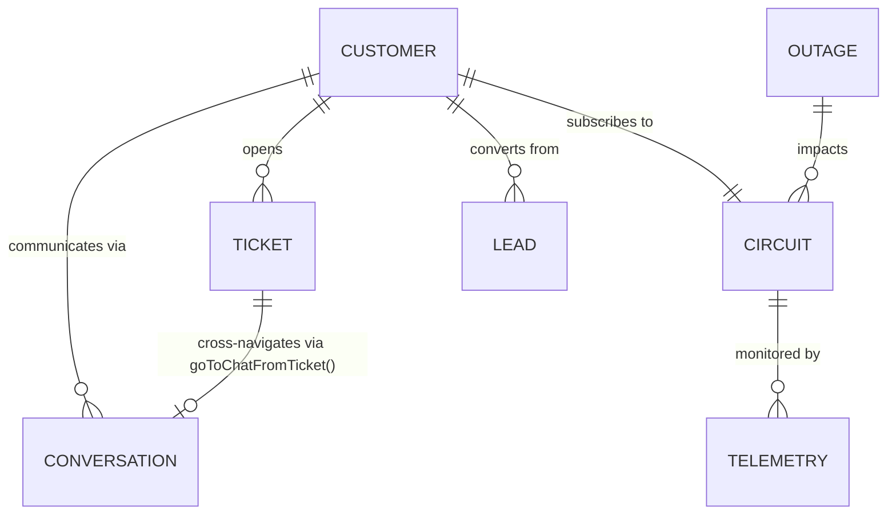

# SpaceNet AI CRM — Shared Data Contract & Architecture Standard

**Document Version:** 1.0.0
**Effective Date:** 2026-10-30
**Authors & Maintainers:** Rohan (Customer-Facing & Support) & Adnan (Operations & Admin)
**Repository:** `https://github.com/lEVI2889/spacenet`
**Current Phase:** Frontend-Only Interactive CRM Demonstration

---

## 1. Project Architecture & Runtime Profile

### 1.1 Pure Client-Side Demonstration Architecture
SpaceNet is an intelligent Customer Relationship Management (CRM) and Network Operations Center (NOC) demonstration platform for high-density internet service providers.

* **Stack:** Vanilla HTML5, Modern ECMAScript (ES6+), styled via Tailwind CSS (MD3-adapted token set).
* **Build System:** Bundled and validated using Vite (`vite build`, output to `dist/`).
* **Runtime State:** Single-page reactive state engine. All state collections reside in-memory within client JavaScript runtime memory (`index.html`).
* **Backend Status:** **No production backend or live network APIs exist.** All network telemetry, customer queries, AI copilot responses, and diagnostic results are simulated locally in the browser.

---

## 2. Identifier Conventions & Registry

To guarantee seamless navigation and referential integrity across modules developed by Rohan (Modules 01–05) and Adnan (Modules 06–10), all fixtures must adhere to the standardized prefix conventions.

### 2.1 Implemented & Standardized Identifiers (Active in Codebase)

| Entity | Canonical Format | UI Display Alias | Example | Implemented In |
| :--- | :--- | :--- | :--- | :--- |
| **Customer** | `CUST-<ID>` | `#<ID>` | `CUST-8832` (`#8832`) | Module 01 (Inbox), Module 03 (Tickets) |
| **Conversation** | `CONV-<CHANNEL_KEY>-<ID>` | N/A | `CONV-WA-8832`, `CONV-IG-6210` | Module 01 (Tasks 1 & 2) |
| **Circuit / Connection** | `SPN-<TYPE>-<ID>` | `SPN-<TYPE>-<ID>` | `SPN-FBR-0941`, `SPN-GAM-6210` | Module 01 (Inbox), Module 03 (Tickets) |
| **Support Ticket** | `TKT-<ID>` | `#TKT-<ID>` | `TKT-1042` (`#TKT-1042`) | Module 03 (Tickets Desk) |
| **Message** | `m-<CUST_ABBR>-<NUM>` | N/A | `m-alx-1`, `m-frh-3` | Module 01 (Tasks 1 & 2) |

### 2.2 Existing but Not Standardized (Active in DOM / Statically Defined)

| Entity | Current Format in DOM | Planned Canonical Format | Notes |
| :--- | :--- | :--- | :--- |
| **Sales Leads** | Stored in Kanban cards without primary key | `LEAD-<NUM>` (e.g. `LEAD-3012`) | Module 06 Kanban cards currently use customer names and companies directly. |
| **Network Outages** | Static banner & modal text | `OUT-<ZONE>-<NUM>` (e.g. `OUT-DAC-0104`) | Module 05/07 severity incident alert banners. |

### 2.3 Proposed Identifiers — Requires Adnan's Review & Agreement

| Entity | Proposed Format | Description | Target Module |
| :--- | :--- | :--- | :--- |
| **Technician Task** | `TASK-TECH-<NUM>` | Field dispatch assignment ID | Module 08 (Field Dispatch) |
| **Invoice / Billing** | `INV-<NUM>` | Billing statement and charge record ID | Module 09 (Billing & Accounts) |
| **ONT Hardware MAC** | `00:E0:4C:<HEX>` | Physical hardware address identifier | Telemetry & Diagnostics |

---

## 3. Conversation Data Schema

Every conversation record in `conversations` conforms to the normalized schema below:

```javascript
{
  // Canonical Identifiers
  conversationId: 'CONV-IG-6210',             // Format: CONV-<CHANNEL>-<ID>
  customerId: 'CUST-6210',                     // Format: CUST-<ID>
  key: 'farhan',                               // Legacy lookup key for backward compatibility
  displayId: '#6210',                          // UI display string

  // Customer Profile
  customerName: 'Farhan Ahmed',
  circuitId: 'SPN-GAM-6210',                   // Link to NOC circuit record
  plan: 'Fiber Gamer 300Mbps',                 // Plan description
  planBadge: 'Fiber Gamer 300M',               // Compact pill label
  planBadgeColor: 'text-tertiary',             // MD3 Tailwind color token

  // Channel & Classification
  channel: 'instagram',                        // Canonical key: 'facebook' | 'instagram' | 'whatsapp' | 'telegram' | 'web'
  channelLabel: 'Instagram',                   // User-facing channel label
  channelBadge: 'IG',                          // Compact 2-letter badge
  channelColor: 'bg-tertiary text-on-tertiary',// Primary badge styling
  badgeColor: 'bg-tertiary-fixed text-on-tertiary-fixed', // Header badge styling
  type: 'dm',                                  // Conversation type: 'dm' | 'comment'
  status: 'ai_handling',                       // State: 'ai_handling' | 'human_takeover'
  unread: false,

  // Metadata Tag
  tag: {
    label: 'Package Inquiry',
    icon: 'sports_esports',                    // Google Material Symbol ligature
    bg: 'bg-tertiary-fixed text-on-tertiary-fixed font-semibold'
  },

  // Message Timeline
  lastMessageTime: '12m ago',
  messages: [
    {
      id: 'm-frh-1',
      sender: 'customer',                      // 'customer' | 'ai' | 'telemetry' | 'system'
      text: 'Hey SpaceNet! Saw your Instagram story...',
      time: '11:20 AM'
    },
    {
      id: 'm-frh-2',
      sender: 'telemetry',                     // Optional optical/diagnostic payload
      opticalRx: '-19.2 dBm',
      ping: '11.4 ms',
      loss: '0.00%',
      text: 'Diagnostic completed.'
    }
  ],

  // Suggested AI Quick Actions
  suggestions: [
    "Yes, we have a Thursday 3:00 PM installation slot open in Banani. Shall I reserve it for you?",
    "Sending the Fiber Gamer 300M spec sheet and monthly pricing breakdown (2,500 BDT/mo)."
  ]
}
```

---

## 4. Messaging Channel Conventions

### 4.1 Canonical Channel Keys
The system recognizes exactly five communication channels. All code must use these lowercase strings:

1. `facebook` — Facebook Messenger
2. `instagram` — Instagram Direct Messages
3. `whatsapp` — WhatsApp Business API
4. `telegram` — Telegram Bot / Channel
5. `web` — SpaceNet Web Portal Live Chat

### 4.2 UI Filter Clarification
* **`all` is strictly a UI filter tab state** (indicating that no channel filtering is applied).
* `all` is **never** a valid `conversation.channel` value on any conversation record.

---

## 5. Cross-Module Relationships & Integration Hooks



### 5.1 Active Integration Hooks (Verified in Code)
* **Ticket → Inbox Navigation (`goToChatFromTicket`):**
  * When a user clicks "Open Chat in Unified Inbox" inside the Ticket Telemetry modal, the application invokes `goToChatFromTicket()`.
  * **Verified Behavior:** Resets `currentChannelFilter` to `'all'`, switches view to `#view-unified-inbox`, and invokes `selectCustomer()` for the corresponding customer record.
* **Backward-Compatibility Adapter (`customerConversations`):**
  * A dictionary indexed by `conversationId`, `customerId`, and legacy `key` provides synchronous access to the canonical `conversations` record array.

### 5.2 Planned Future Integration Hooks
* **Inbox → Lead Candidate (Module 01 → Module 06):** Inbound inquiries from new leads (e.g. Farhan Ahmed package inquiry) will provide an "Export to Sales Pipeline" action button that creates a `LEAD` card in the Kanban board.
* **Inbox → Ticket Escalation (Module 01 → Module 03):** Chat stream action allowing customer support to escalate an unresolved issue directly into a new `TKT-<ID>` ticket pre-populated with optical diagnostics.

---

## 6. Developer Ownership & Coordination Agreement

| Module Range | Domain Area | Lead Owner | Shared Coordination Requirement |
| :--- | :--- | :--- | :--- |
| **Modules 01–05** | Customer-Facing, Unified Inbox, AI Diagnostics, Tickets, UI Consistency | **Rohan** | Must not alter Adnan's Kanban or Outage markup without handoff consensus. |
| **Modules 06–10** | Sales Pipeline, Outages, Field Dispatch, Billing, Analytics & NOC Admin | **Adnan** | Must reuse standard `CUST-<ID>`, `circuitId`, and customer records from this contract. |

### Collaboration Rules:
1. **Never Duplicate Customers:** If a customer exists in the inbox fixtures (e.g. `CUST-8832` Alex Rivera), references to that customer in Tickets, Sales, or Outages must share the same `customerId` and circuit ID.
2. **Backward-Compatibility Protection:** Neither developer will remove `customerConversations`, legacy router keys, or change global function signatures without mutual review.

---

## 7. Demo Data Fixture Registry

The 5 simulated customer conversations currently implemented:

| Customer Name | Customer ID | Conversation ID | Channel | Plan | Circuit ID | Fictional Context |
| :--- | :--- | :--- | :--- | :--- | :--- | :--- |
| **Alex Rivera** | `CUST-8832` | `CONV-WA-8832` | `whatsapp` | Fiber 500Mbps | `SPN-FBR-0941` | Wi-Fi 2.4/5GHz channel optimization diagnostic |
| **Sarah Jenkins** | `CUST-4491` | `CONV-FB-4491` | `facebook` | Office Pro 1Gbps | `SPN-OFF-2281` | Static IP & subnet expansion for cloud servers |
| **Farhan Ahmed** | `CUST-6210` | `CONV-IG-6210` | `instagram` | Fiber Gamer 300Mbps | `SPN-GAM-6210` | Low-latency gaming package inquiry for Banani |
| **Marcus Vance** | `CUST-1092` | `CONV-WEB-1092` | `web` | Home Lite 100M | `SPN-VDS-1092` | Bill payment inquiry & gateway speed verification |
| **Elena Rostov** | `CUST-7721` | `CONV-TG-7721` | `telegram` | Fiber Gigabit | `SPN-CORP-7721` | BGP failover & secondary trunk failover check |

> [!NOTE]
> **Fictional Data Disclaimer:** All pricing statements (e.g. 2,500 BDT/mo), coverage nodes (e.g. Banani Block B & C), latency benchmarks (<5ms), hardware models (Wi-Fi 6 GPON ONT #8832), and installation schedules are simulated demonstration fixtures and do not represent contractual commitments or production network guarantees of SpaceNet.

---

## 8. Extension Guidelines for Future Coding Agents

1. **Adding New Conversations:**
   * Append new items to the canonical `conversations` array inside `index.html`.
   * Ensure `channel` is one of the 5 canonical channel keys (`facebook`, `instagram`, `whatsapp`, `telegram`, `web`).
   * Ensure `conversationId` and `customerId` follow Section 2.
   * Run `syncLegacyCustomerConversations()` or verify automatic adapter registration.
2. **Adding New Tickets or Leads:**
   * When creating new ticket or lead fixtures, link them to an existing `CUST-<ID>` whenever possible.
   * If a new customer must be introduced, add the corresponding customer record to both the Inbox and the target module simultaneously.
3. **DOM Element Safety:**
   * Do not remove established DOM target IDs: `#inbox-thread-list`, `#chat-customer-name`, `#chat-customer-avatar`, `#chat-channel-badge`, `#chat-circuit-plan`, `#chat-message-stream`.
