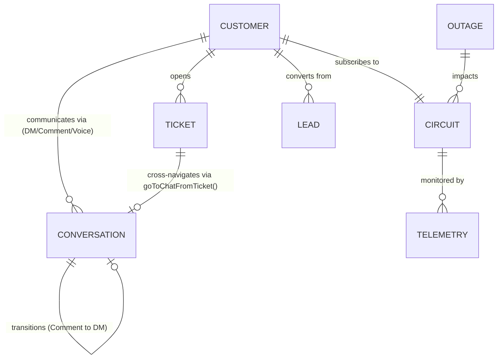

# SpaceNet AI CRM — Shared Data Contract & Architecture Standard

**Document Version:** 1.2.0
**Effective Date:** 2026-10-30
**Authors & Maintainers:** Rohan (Customer-Facing & Support Lead) & Adnan (Operations & Admin Lead)
**Repository:** `https://github.com/lEVI2889/spacenet`
**Current Phase:** Frontend-Only Interactive CRM Demonstration

---

## 1. Project Architecture & Runtime Profile

### 1.1 Pure Client-Side Demonstration Architecture
SpaceNet is an intelligent Customer Relationship Management (CRM) and Network Operations Center (NOC) demonstration platform for high-density internet service providers.

* **Stack:** Vanilla HTML5, Modern ECMAScript (ES6+), styled via Tailwind CSS (MD3-adapted token set).
* **Build System:** Bundled and validated using Vite (`vite build`, output to `dist/`).
* **Runtime State:** Single-page reactive state engine. All state collections reside in-memory within client JavaScript runtime memory (`index.html`).
* **Backend Status:** **No production backend or live network APIs exist.** All network telemetry, customer queries, AI copilot responses, social feeds, simulated voice notes, and diagnostic results are simulated locally in the browser without external network calls or cloud dependencies.

---

## 2. Identifier Conventions & Registry

To guarantee seamless navigation and referential integrity across modules developed by Rohan (Modules 01–05) and Adnan (Modules 06–10), all fixtures must adhere to the standardized prefix conventions.

### 2.1 Implemented & Standardized Identifiers (Active in Codebase)

| Entity | Canonical Format | UI Display Alias | Example | Implemented In |
| :--- | :--- | :--- | :--- | :--- |
| **Customer** | `CUST-<ID>` | `#<ID>` | `CUST-8832` (`#8832`), `CUST-5120` (`#5120`) | Module 01 (Inbox), Module 03 (Tickets) |
| **Conversation** | `CONV-<CHANNEL_KEY>-<ID>` | N/A | `CONV-WA-8832`, `CONV-FB-5120` | Module 01 (Tasks 1–5) |
| **Linked Private DM** | `CONV-<CHANNEL_KEY>-<ID>-DM` | N/A | `CONV-FB-5120-DM` | Module 02 (Feature Group 3) |
| **Circuit / Connection** | `SPN-<TYPE>-<ID>` | `SPN-<TYPE>-<ID>` | `SPN-FBR-0941`, `SPN-GAM-3340` | Module 01 (Inbox), Module 03 (Tickets) |
| **Support Ticket** | `TKT-<ID>` | `#TKT-<ID>` | `TKT-1042` (`#TKT-1042`) | Module 03 (Tickets Desk) |
| **Standard Message** | `m-<CUST_ABBR>-<NUM>` or `msg-<TIMESTAMP>` | N/A | `m-alx-1`, `msg-1730301234` | Module 01 (Tasks 1–5) |
| **Voice Note Message** | `vmsg-<CUST_ABBR>-<NUM>` | N/A | `vmsg-alx-1`, `vmsg-frh-1` | Module 02 (Feature Group 6) |
| **System Event Log** | `sys-<TIMESTAMP>` | N/A | `sys-1730302345` | Module 01 (Task 4) |
| **Transition Event Log** | `sys-trans-<TIMESTAMP>` | N/A | `sys-trans-1730304444` | Module 02 (Feature Group 3) |
| **Internal Staff Note** | `note-<TIMESTAMP>` | N/A | `note-1730303456` | Module 01 (Task 5) |

### 2.2 Existing but Not Standardized (Active in DOM / Statically Defined)

| Entity | Current Format in DOM | Planned Canonical Format | Notes |
| :--- | :--- | :--- | :--- |
| **Sales Leads** | Stored in Kanban cards without primary key | `LEAD-<NUM>` (e.g. `LEAD-3012`) | Module 06 Kanban cards currently use customer names and companies directly. |
| **Network Outages** | Static banner & modal text | `OUT-<ZONE>-<NUM>` (e.g. `OUT-DAC-0104`) | Module 05/07 severity incident alert banners. |

### 2.3 Proposed Identifiers — Requires Adnan's Review & Agreement

| Entity | Proposed Format | Description | Target Module |
| :--- | :--- | :--- | :--- |
| **Technician Task** | `TASK-TECH-<NUM>` | Field dispatch assignment ID | Module 08 (Field Dispatch) |
| **Invoice / Billing** | `INV-<NUM>` | Billing statement and charge record ID | Module 09 (Billing & Accounts) |
| **ONT Hardware MAC** | `00:E0:4C:<HEX>` | Physical hardware address identifier | Telemetry & Diagnostics |

---

## 3. Normalized Conversation Data Schema

Every conversation record in `conversations` conforms to the normalized schema below:

```javascript
{
  // Canonical Identifiers
  conversationId: 'CONV-FB-5120',             // Format: CONV-<CHANNEL>-<ID> (or ...-DM for linked DMs)
  customerId: 'CUST-5120',                     // Format: CUST-<ID>
  key: 'tanvir',                               // Legacy lookup key for backward compatibility
  displayId: '#5120',                          // UI display string

  // Customer Profile
  customerName: 'Tanvir Hossain',
  circuitId: 'SPN-FBR-5120',                   // Link to NOC circuit record
  plan: 'Fiber Home 150Mbps',                  // Plan description
  planBadge: 'Fiber Home 150M',                // Compact pill label
  planBadgeColor: 'text-primary',              // MD3 Tailwind color token

  // Channel & Classification
  channel: 'facebook',                        // Canonical key: 'facebook' | 'instagram' | 'whatsapp' | 'telegram' | 'web'
  channelLabel: 'Facebook',                   // User-facing channel label
  channelBadge: 'FB',                          // Compact 2-letter badge
  channelColor: 'bg-primary text-on-primary',  // Primary badge styling
  badgeColor: 'bg-primary-fixed text-on-primary-fixed', // Header badge styling
  type: 'comment',                             // Conversation type: 'dm' | 'comment'
  status: 'ai_handling',                       // Control state: 'ai_handling' | 'human_takeover'
  unread: false,

  // Metadata Tag
  tag: {
    label: 'Facebook Comment',
    icon: 'forum',                             // Google Material Symbol ligature
    bg: 'bg-primary-fixed text-on-primary-fixed font-semibold'
  },

  // Parent Social Post Context (Required when type === 'comment')
  postContext: {
    platform: 'Facebook',                      // 'Facebook' | 'Instagram'
    pageName: 'SpaceNet Broadband',
    postSnippet: 'Monsoon Fiber Upgrade Campaign: Free Wi-Fi 6 router upgrades...',
    postTime: '2 hours ago',
    permalink: 'https://facebook.com/spacenet/posts/98120341'
  },

  // Linked Private DM Context (Present when conversation is a linked private transition)
  originCommentId: 'CONV-FB-5120',             // Optional reference to originating public comment
  originPostSnippet: 'Monsoon Fiber Upgrade Campaign...', // Optional excerpt of parent post

  // Message Timeline (Polymorphic Message Array)
  lastMessageTime: 'Just now',
  messages: [
    // 1. Inbound Customer Message / Comment
    {
      id: 'm-tnv-1',
      sender: 'customer',                      // 'customer' | 'ai' | 'staff' | 'telemetry' | 'system' | 'note' | 'voice'
      text: 'Is Dhanmondi Road 27 covered under this Monsoon promotion?',
      time: '12:10 PM'
    },
    // 2. Outgoing Staff Message (under Human Takeover)
    {
      id: 'msg-1730301111',
      sender: 'staff',
      author: 'Rohan (Tier III NOC)',
      text: 'Yes Tanvir! Dhanmondi Road 27 is fully upgraded to our GPON ring.',
      time: '12:14 PM'
    },
    // 3. System Audit Event (takeover | handback | transition)
    {
      id: 'sys-trans-1730302222',
      sender: 'system',
      eventType: 'transition',                 // 'takeover' | 'handback' | 'transition'
      text: 'Privacy Transition: Thread transitioned from public comment on Facebook post to secure 1:1 Direct Message.',
      time: '12:12 PM'
    },
    // 4. Internal Private Note (Team Only)
    {
      id: 'note-1730303333',
      sender: 'note',
      isInternal: true,
      author: 'Rohan (Tier III NOC)',
      text: 'Verified customer circuit SPN-FBR-5120 on Dhanmondi OLT-04 port 2.',
      time: '12:15 PM'
    },
    // 5. Simulated Voice Note (Module 02)
    {
      id: 'vmsg-alx-1',
      sender: 'voice',
      customerInitials: 'AR',
      duration: '0:34',
      audioSource: 'WhatsApp Voice Note (44.1 kHz Opus)',
      language: 'English',                     // 'English' | 'বাংলা (Bangla)' | 'Banglish'
      transcript: 'Hey support, my 5GHz Wi-Fi network disappeared...',
      detectedIntent: 'Technical Troubleshooting (Wi-Fi Radio)',
      confidence: '97% Match',
      keyEntities: ['5GHz Band', 'Wi-Fi Radio', 'Dual-Band Router'],
      suggestedAction: 'Run 5GHz radio diagnostic & separate SSID bands',
      suggestedReply: 'I ran a remote sweep on your GPON ONT...',
      time: '10:45 AM'
    }
  ],

  // Suggested AI Quick Actions
  suggestions: [
    "Yes, Dhanmondi Road 27 is fully eligible for the free Wi-Fi 6 router upgrade.",
    "Would you like me to book our field tech for router swap this Thursday?"
  ]
}
```

---

## 4. Public Comment to Private DM Transition & Linked DM Contracts

### 4.1 Transition Flow & One-Click Invitation
When a customer inquires on a public social post (`type: 'comment'`), sharing sensitive personal data (e.g. phone number, installation address) publicly is discouraged.
1. The AI Copilot displays `#comment-to-dm-banner` with a recommendation to invite the subscriber to a private message.
2. Clicking `[Insert Public DM Invitation]` (`insertPublicDmInvite()`) populates an editable, language-tailored public comment in the composer.
3. Clicking `[Continue in Private DM]` (`continueInPrivateDm()`) transitions the workspace to a linked private conversation.

### 4.2 Idempotency & Duplicate Prevention
To prevent thread fragmentation during repeated transitions:
* The linked private thread adopts a predictable canonical ID: `${currentConv.conversationId}-DM` (e.g. `CONV-FB-5120-DM`).
* Lookup checks both `c.conversationId === targetDmConvId` and `c.originCommentId === currentConv.conversationId`.
* If a linked DM thread already exists, `continueInPrivateDm()` immediately navigates to it without duplicating entries in `conversations`.
* Private internal staff notes (`isInternal: true`) are strictly filtered out and never leaked into customer-visible threads during transition.

### 4.3 Transition Audit Event
Whenever a transition occurs, a permanent audit record is inserted into the linked private thread:
```javascript
{
  id: 'sys-trans-' + Date.now(),
  sender: 'system',
  eventType: 'transition',
  text: 'Privacy Transition: Thread transitioned from public comment on ' + (originConv.channelLabel || originConv.channel) + ' post to secure 1:1 Direct Message.',
  time: timeStr
}
```

---

## 5. Knowledge Base & Intent Classification Integration Contract (Module 02)

Module 02 introduces a deterministic, client-side conversational intelligence pipeline that classifies inquiries, extracts entities, and synthesizes structured multi-point answers.

### 5.1 Knowledge Base Categories (`SPACE_NET_KNOWLEDGE_BASE`)
The knowledge base comprises 9 structured ISP topics:
1. `packages_pricing`: Residential & business bandwidth packages, speed tiers, monthly pricing.
2. `coverage_availability`: Service coverage across Dhaka metropolitan zones.
3. `installation_procedure`: Deployment fees, standard setup timelines, free installation thresholds.
4. `billing_guidance`: Payment methods (bKash, Nagad, bank transfers), billing cycles, invoice download guidance.
5. `package_changes`: Upgrades (instant, free) and downgrades (effective next billing cycle).
6. `service_policies_sla`: Uptime SLAs (99.9% residential, 99.99% enterprise) and outage service-credit compensation.
7. `support_hours`: 24/7/365 NOC availability and daily field dispatch hours (8:00 AM – 10:00 PM).
8. `technical_problem`: Optical power sweep, PON/LOS indicator troubleshooting, ONT reboot sequence.
9. `human_escalation`: Explicit escalation request acknowledgment for Tier III NOC engineering.

### 5.2 Intent Classification Contract (`classifyCustomerIntent`)
Every customer inquiry is processed by `classifyCustomerIntent(text, preferredLang)`, returning a standardized classification payload:
```typescript
interface IntentClassificationResult {
  intent: string;                              // e.g. "packages_pricing" | "coverage_availability"
  confidence: number;                          // Decimal score (0.00 – 0.99)
  route: 'ticket_suggest' | 'sales_handoff' | 'billing_guidance' | 'faq' | 'noc_escalate';
  isMultiIntent: boolean;                      // True when >= 2 distinct strong intents are detected
  intents: string[];                           // Array of matched category keys
  entities: {
    packages: string[];                        // Extracted packages (e.g. ["Fiber Gamer 300Mbps"])
    coverageZones: string[];                   // Extracted zones (e.g. ["Banani"])
  };
  response: string;                            // Synthesized language-specific response text
}
```

### 5.3 Multi-Intent Recognition & 3-Point Response Synthesis
* **Compound Recognition:** If an inquiry contains up to 3 distinct intents with strong independent keyword matches (e.g. *"How much is the installation fee for Fiber Gamer 300M, and is it available in Banani?"*), `classifyCustomerIntent` detects all three: `packages_pricing`, `installation_procedure`, and `coverage_availability`.
* **Structured Synthesis:** Generates a clean, numbered multi-point response (`1. [Price]`, `2. [Installation]`, `3. [Coverage]`) formatted in the active language mode.
* **Targeted Entity Responses:** If a specific package is named (e.g. *Fiber Gamer 300M*), the system outputs that specific tier (2,500 BDT/mo) and free installation qualification rather than dumping the entire 6-package catalog.

### 5.4 Multilingual Support & Unicode Normalization
* Supported Language Modes: English (`EN`), বাংলা (`BN`), and Banglish (Romanized Bengali).
* Script Priority: Explicit selection via `#chat-ai-lang-selector` takes priority over automatic script detection.
* Bengali Script Normalization: Keyword tokenization applies Unicode Category `\p{M}` (combining vowel marks, hasants, and nuktas) alongside `\p{L}` (`/[^\p{L}\p{M}\p{N}\s]/gu`) to prevent Bengali characters from splitting into disconnected glyphs.

### 5.5 Customer Frustration Detection
* Rule-based scanner (`detectCustomerFrustration`) identifies dissatisfaction keywords ("still not working", "3rd time", "worst service", "কাজ করছে না", "biroktikor").
* Displays `#chat-frustration-alert` with an immediate `[Escalate to Human NOC]` action button.
* Frustration UI is strictly decoupled from intent classification; historical frustration does not overwrite the current inquiry's detected topic.

---

## 6. Customer Message Simulator (`#demo-customer-simulator-strip`)

To facilitate evaluation and QA testing without live messaging networks, Module 02 provides an interactive simulation toolbar:
* **UI Location:** Rendered directly above `#chat-message-stream`.
* **Controls:** Quick preset dropdown with 6 realistic test scenarios, custom message input, and `[Simulate]` trigger.
* **Execution:** Calls `executeSimulateCustomerMessage()`, injecting the message as `sender: 'customer'`.
* **Safety Boundaries:**
  * Strictly checks `conv.status === 'human_takeover'`. When takeover is active, incoming simulated messages are logged without triggering automated AI responses.
  * Message injection is isolated strictly to the active conversation thread.
  * Operates 100% in-memory; issues no network requests to external social platforms.

---

## 7. Demo-Only Commercial & Technical Safeguards

> [!IMPORTANT]
> **Fictional Data & Demonstration Boundaries:**
> 1. **Financial Safeguards:** All payment accounts displayed in billing responses explicitly carry prominent demo warnings: `bKash Merchant: 01700-000000 (DEMO-SIMULATION ONLY — Use Customer ID as reference)`. Reviewers and users must not transfer real funds.
> 2. **Commercial Pricing & Coverage:** Speed tiers, pricing (e.g. 2,500 BDT/mo), installation discounts, and coverage availability are simulated fixtures and do not represent legally binding SpaceNet business commitments.
> 3. **AI Determinism:** Conversational AI capabilities are executed using deterministic local rules and knowledge maps. No external LLM APIs (OpenAI, Gemini, Anthropic) or live network tokens are used.
> 4. **Voice Transcription Simulation:** Voice messages are simulated with pre-rendered waveform graphics and mock transcript records. No microphone access, audio recording, or speech-to-text APIs are employed.
> 5. **Privacy & Security Boundaries:** Internal staff notes and human takeover flags are maintained client-side in memory. No server-side authentication, role-based access control (RBAC), or cryptographic separation exists in this frontend demonstration prototype.

---

## 8. Cross-Module Relationships & Integration Hooks



### 8.1 Active Integration Hooks (Verified in Code)
* **Ticket → Inbox Navigation (`goToChatFromTicket`):** Resets channel and type filters to `'all'`, switches view to `#view-unified-inbox`, and selects the customer thread.
* **Comment → DM Transition (`continueInPrivateDm`):** Opens or creates linked private conversation `${conv.conversationId}-DM` preserving origin references.
* **Copilot Intent Routing (`handleRoutingAction`):**
  * `ticket_suggest`: Navigates to Module 03 (Support Tickets Desk).
  * `sales_handoff`: Navigates to Module 06 (Sales & Leads Pipeline).
  * `billing_guidance`: Recommends billing desk review.

---

## 9. Developer Ownership & Coordination Agreement

| Module Range | Domain Area | Lead Owner | Shared Coordination Requirement |
| :--- | :--- | :--- | :--- |
| **Modules 01–05** | Customer-Facing, Unified Inbox, AI Diagnostics, Tickets, UI Consistency | **Rohan** | Must not alter Adnan's Kanban or Outage markup without handoff consensus. |
| **Modules 06–10** | Sales Pipeline, Outages, Field Dispatch, Billing, Analytics & NOC Admin | **Adnan** | Must reuse standard `CUST-<ID>`, `circuitId`, and customer records from this contract. |

### Collaboration Rules:
1. **Never Duplicate Customers:** If a customer exists in the inbox fixtures (e.g. `CUST-8832` Alex Rivera), references to that customer in Tickets, Sales, or Outages must share the same `customerId` and circuit ID.
2. **Backward-Compatibility Protection:** Neither developer will remove `customerConversations`, legacy router keys, or change global function signatures without mutual review.

---

## 10. Demo Data Fixture Registry (7 Base + 1 Linked DM + Voice Fixtures)

| Customer Name | Customer ID | Conversation ID | Channel | Type | Status | Plan | Fictional Context & Features |
| :--- | :--- | :--- | :--- | :--- | :--- | :--- | :--- |
| **Alex Rivera** | `CUST-8832` | `CONV-WA-8832` | `whatsapp` | `dm` | `ai_handling` | Fiber 500M | Wi-Fi 5GHz channel optimization; **English Voice Note (`vmsg-alx-1`)** |
| **Sarah Jenkins** | `CUST-4491` | `CONV-FB-4491` | `facebook` | `dm` | `ai_handling` | Office Pro 1G | Static IP subnet expansion; internal staff note fixture |
| **Farhan Ahmed** | `CUST-6210` | `CONV-IG-6210` | `instagram` | `dm` | `ai_handling` | Gamer 300M | Banani esports latency inquiry; **Bangla Voice Note (`vmsg-frh-1`)** |
| **Marcus Vance** | `CUST-1092` | `CONV-WEB-1092` | `web` | `dm` | `ai_handling` | Home Lite 100M | Bill payment inquiry & gateway speed verification |
| **Elena Rostov** | `CUST-7721` | `CONV-TG-7721` | `telegram` | `dm` | `ai_handling` | Fiber Gigabit | bKash merchant billing payment; **Banglish Voice Note (`vmsg-eln-1`)** |
| **Tanvir Hossain** | `CUST-5120` | `CONV-FB-5120` | `facebook` | `comment` | `ai_handling` | Home 150M | Monsoon Wi-Fi 6 upgrade post comment; internal note; **Linked DM transition target** |
| **Tanvir Hossain (DM)** | `CUST-5120` | `CONV-FB-5120-DM` | `facebook` | `dm` | `ai_handling` | Home 150M | **Linked 1:1 Private DM** transitioned from public comment; privacy audit event |
| **Nabila Karim** | `CUST-3340` | `CONV-IG-3340` | `instagram` | `comment` | `ai_handling` | Streamer 200M | Esports latency inquiry on IG Reel; postContext |

---

## 11. Extension Guidelines for Future Coding Agents

1. **Adding New Conversations:**
   * Append new items to the canonical `conversations` array inside `index.html`.
   * Ensure `channel` is one of the 5 canonical channel keys (`facebook`, `instagram`, `whatsapp`, `telegram`, `web`).
   * Ensure `type` is `'dm'` or `'comment'` (with `postContext` if `'comment'`).
   * Ensure `status` is `'ai_handling'` or `'human_takeover'`.
   * Ensure `conversationId` and `customerId` follow Section 2.
   * Run `syncLegacyCustomerConversations()` or verify automatic adapter registration.
2. **Adding Voice Messages:**
   * Add message object with `sender: 'voice'` conforming to Section 3 schema.
3. **Adding Knowledge Base Answers:**
   * Extend `SPACE_NET_KNOWLEDGE_BASE` categories in `index.html` with explicit English, Bengali (`bn`), and Banglish (`banglish`) answers. Include prominent demo notices for any simulated financial numbers.
4. **DOM Element Safety:**
   * Do not remove established DOM target IDs: `#inbox-thread-list`, `#inbox-filter-strip`, `#inbox-type-filter-strip`, `#chat-post-context-banner`, `#comment-to-dm-banner`, `#chat-frustration-alert`, `#chat-ai-routing-banner`, `#demo-customer-simulator-strip`, `#chat-customer-name`, `#chat-customer-avatar`, `#chat-channel-badge`, `#chat-circuit-plan`, `#chat-message-stream`, `#agent-override-toggle`, `#chat-composer-container`.
