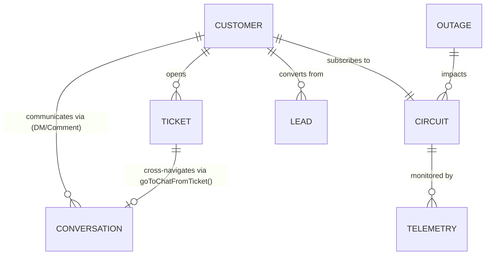

# SpaceNet AI CRM — Shared Data Contract & Architecture Standard

**Document Version:** 1.1.0
**Effective Date:** 2026-10-30
**Authors & Maintainers:** Rohan (Customer-Facing & Support Lead) & Adnan (Operations & Admin Lead)
**Repository:** `https://github.com/lEVI2889/spacenet`
**Current Phase:** Frontend-Only Interactive CRM Demonstration

---

## 1. Project Architecture & Runtime Profile

### 1.1 Pure Client-Side Demonstration Architecture
SpaceNet is an intelligent Customer Relationship Management (CRM) and Network Operations Center (NOC) demonstration platform for high-density internet service providers.

* **Stack:** Vanilla HTML5, Modern ECMAScript (ES6+), styled via Tailwind CSS (MD3-adapted token set).
* **Build System:** Bundled and validated using Vite (`vite build`, output to `dist/`).
* **Runtime State:** Single-page reactive state engine. All state collections reside in-memory within client JavaScript runtime memory (`index.html`).
* **Backend Status:** **No production backend or live network APIs exist.** All network telemetry, customer queries, AI copilot responses, social feeds, and diagnostic results are simulated locally in the browser.

---

## 2. Identifier Conventions & Registry

To guarantee seamless navigation and referential integrity across modules developed by Rohan (Modules 01–05) and Adnan (Modules 06–10), all fixtures must adhere to the standardized prefix conventions.

### 2.1 Implemented & Standardized Identifiers (Active in Codebase)

| Entity | Canonical Format | UI Display Alias | Example | Implemented In |
| :--- | :--- | :--- | :--- | :--- |
| **Customer** | `CUST-<ID>` | `#<ID>` | `CUST-8832` (`#8832`), `CUST-5120` (`#5120`) | Module 01 (Inbox), Module 03 (Tickets) |
| **Conversation** | `CONV-<CHANNEL_KEY>-<ID>` | N/A | `CONV-WA-8832`, `CONV-FB-5120` | Module 01 (Tasks 1–5) |
| **Circuit / Connection** | `SPN-<TYPE>-<ID>` | `SPN-<TYPE>-<ID>` | `SPN-FBR-0941`, `SPN-GAM-3340` | Module 01 (Inbox), Module 03 (Tickets) |
| **Support Ticket** | `TKT-<ID>` | `#TKT-<ID>` | `TKT-1042` (`#TKT-1042`) | Module 03 (Tickets Desk) |
| **Standard Message** | `m-<CUST_ABBR>-<NUM>` or `msg-<TIMESTAMP>` | N/A | `m-alx-1`, `msg-1730301234` | Module 01 (Tasks 1–5) |
| **System Event Log** | `sys-<TIMESTAMP>` | N/A | `sys-1730302345` | Module 01 (Task 4) |
| **Internal Staff Note** | `note-<TIMESTAMP>` | N/A | `note-1730303456` | Module 01 (Task 5) |

### 2.2 Existing but Not Standardized (Active in DOM / Statically Defined)

| Entity | Current Format in DOM | Planned Canonical Format | Notes |
| :--- | :--- | :--- | :--- |
| **Sales Leads** | Stored in Kanban cards without primary key | `LEAD-<NUM>` (e.g. `LEAD-3012`) | Module 06 Kanban cards currently use customer names and companies directly. |
| **Network Outages** | Static banner & modal text | `OUT-<ZONE>-<NUM>` (e.g. `OUT-DAC-0104`) | Module 05/07 severity incident alert banners. |

### 2.3 Proposed Identifiers — Requires Adnan's Review & Agreement

| Entity | Proposed Format | Description | Target Module |
| :--- | :--- | :--- | :--- |
| **Technician Task** | `TASK-TECH-<NUM>` | Field dispatch assignment ID | Module 08 (Field Dispatch) |
| **Invoice / Billing** | `INV-<NUM>` | Billing statement and charge record ID | Module 09 (Billing & Accounts) |
| **ONT Hardware MAC** | `00:E0:4C:<HEX>` | Physical hardware address identifier | Telemetry & Diagnostics |

---

## 3. Normalized Conversation Data Schema

Every conversation record in `conversations` conforms to the normalized schema below:

```javascript
{
  // Canonical Identifiers
  conversationId: 'CONV-FB-5120',             // Format: CONV-<CHANNEL>-<ID>
  customerId: 'CUST-5120',                     // Format: CUST-<ID>
  key: 'tanvir',                               // Legacy lookup key for backward compatibility
  displayId: '#5120',                          // UI display string

  // Customer Profile
  customerName: 'Tanvir Hossain',
  circuitId: 'SPN-FBR-5120',                   // Link to NOC circuit record
  plan: 'Fiber Home 150Mbps',                  // Plan description
  planBadge: 'Fiber Home 150M',                // Compact pill label
  planBadgeColor: 'text-primary',              // MD3 Tailwind color token

  // Channel & Classification
  channel: 'facebook',                        // Canonical key: 'facebook' | 'instagram' | 'whatsapp' | 'telegram' | 'web'
  channelLabel: 'Facebook',                   // User-facing channel label
  channelBadge: 'FB',                          // Compact 2-letter badge
  channelColor: 'bg-primary text-on-primary',  // Primary badge styling
  badgeColor: 'bg-primary-fixed text-on-primary-fixed', // Header badge styling
  type: 'comment',                             // Conversation type: 'dm' | 'comment'
  status: 'ai_handling',                       // Control state: 'ai_handling' | 'human_takeover'
  unread: false,

  // Metadata Tag
  tag: {
    label: 'Facebook Comment',
    icon: 'forum',                             // Google Material Symbol ligature
    bg: 'bg-primary-fixed text-on-primary-fixed font-semibold'
  },

  // Parent Social Post Context (Required when type === 'comment')
  postContext: {
    platform: 'Facebook',                      // 'Facebook' | 'Instagram'
    pageName: 'SpaceNet Broadband',
    postSnippet: 'Monsoon Fiber Upgrade Campaign: Free Wi-Fi 6 router upgrades...',
    postTime: '2 hours ago',
    permalink: 'https://facebook.com/spacenet/posts/98120341'
  },

  // Message Timeline (Polymorphic Message Array)
  lastMessageTime: 'Just now',
  messages: [
    // 1. Inbound Customer Message / Comment
    {
      id: 'm-tnv-1',
      sender: 'customer',                      // 'customer' | 'ai' | 'staff' | 'telemetry' | 'system' | 'note'
      text: 'Is Dhanmondi Road 27 covered under this Monsoon promotion?',
      time: '12:10 PM'
    },
    // 2. Outgoing Staff Message (under Human Takeover)
    {
      id: 'msg-1730301111',
      sender: 'staff',
      author: 'Rohan (Tier III NOC)',
      text: 'Yes Tanvir! Dhanmondi Road 27 is fully upgraded to our GPON ring.',
      time: '12:14 PM'
    },
    // 3. System Audit Event
    {
      id: 'sys-1730302222',
      sender: 'system',
      eventType: 'takeover',                   // 'takeover' | 'handback'
      text: 'Human Takeover: Session reassigned from AI Copilot to Support Staff (Rohan / Tier III NOC). AI auto-responses paused.',
      time: '12:12 PM'
    },
    // 4. Internal Private Note (Team Only)
    {
      id: 'note-1730303333',
      sender: 'note',
      isInternal: true,
      author: 'Rohan (Tier III NOC)',
      text: 'Verified customer circuit SPN-FBR-5120 on Dhanmondi OLT-04 port 2.',
      time: '12:15 PM'
    }
  ],

  // Suggested AI Quick Actions
  suggestions: [
    "Yes, Dhanmondi Road 27 is fully eligible for the free Wi-Fi 6 router upgrade.",
    "Would you like me to book our field tech for router swap this Thursday?"
  ]
}
```

---

## 4. Messaging Channel & Conversation Type Conventions

### 4.1 Canonical Channel Keys
The system recognizes exactly five communication channels. All code must use these lowercase strings:

1. `facebook` — Facebook Messenger / Facebook Page Comments
2. `instagram` — Instagram Direct Messages / Instagram Reel Comments
3. `whatsapp` — WhatsApp Business API
4. `telegram` — Telegram Bot / Channel
5. `web` — SpaceNet Web Portal Live Chat

### 4.2 Conversation Types (`type`)
* **`dm` (Direct Message):** Private 1:1 communication stream with subscriber. Parent post context banner is hidden.
* **`comment` (Public Post Comment):** Public customer interaction under a brand post. Displays `#chat-post-context-banner` with official page name, excerpt, and permalink.

### 4.3 UI Filter Strip Matrix
The Unified Inbox provides two complementary filter strips that intersect with live search:
* **Channel Filter (`#inbox-filter-strip`):** `all`, `whatsapp`, `facebook`, `instagram`, `telegram`, `web`.
* **Type Filter (`#inbox-type-filter-strip`):** `all`, `dm`, `comment`.
* *Note:* `all` is strictly a UI filter tab state, never a stored attribute on conversation objects.

---

## 5. Control State & System Audit Events (Task 4)

### 5.1 Per-Thread Ownership State
* **`conv.status: 'ai_handling'` (Default):** SpaceNet AI Copilot monitors the conversation and automatically provides smart suggestions and scheduled automated customer simulations.
* **`conv.status: 'human_takeover'`:** Staff engineer has engaged manual control. AI auto-responses and scheduled timeouts are cancelled. Outgoing messages are attributed to `sender: 'staff'` with `author: 'Rohan (Tier III NOC)'`.

### 5.2 System Audit Events
Whenever ownership toggles, a structured system log message is appended to `conv.messages`:
* **Takeover Event:**
  ```javascript
  {
    id: 'sys-' + Date.now(),
    sender: 'system',
    eventType: 'takeover',
    text: 'Human Takeover: Session reassigned from AI Copilot to Support Staff (Rohan / Tier III NOC). AI auto-responses paused.',
    time: timeStr
  }
  ```
* **Handback Event:**
  ```javascript
  {
    id: 'sys-' + Date.now(),
    sender: 'system',
    eventType: 'handback',
    text: 'AI Handback: Human agent returned conversation control to SpaceNet AI Copilot. Automated monitoring active.',
    time: timeStr
  }
  ```
* **Idempotence Rule:** State changes must verify that `conv.status !== targetStatus` prior to appending audit events to prevent redundant logs.

---

## 6. Internal Private Notes System (Task 5)

### 6.1 Schema & Structure
Internal notes are stored directly within `conv.messages` using the `note` sender signature:
```javascript
{
  id: 'note-' + Date.now(),
  sender: 'note',
  isInternal: true,
  author: 'Rohan (Tier III NOC)',
  text: noteBody,
  time: timeStr
}
```

### 6.2 Rendering & UI Separation
* **Styling:** Rendered inline in the message stream inside an amber-tinted container (`bg-amber-500/10 border-amber-500/30`) with a lock icon, timestamp, staff attribution, and a `"STAFF ONLY"` badge.
* **Composer Isolation:** In Note Mode, the composer transforms visually to amber styling with an "Add Note" button.

### 6.3 Demo Privacy Notice & Safety Boundaries
> [!IMPORTANT]
> **Demo Architecture vs Production Privacy:**
> * In this frontend demonstration, internal notes are separated client-side in memory and visually styled with strict staff indicators.
> * Creating an internal note strictly suppresses customer simulation responses, AI copilot replies, and public posts.
> * However, **there is no backend database, server-side authentication, or role-based access control (RBAC) in this demo**. In a future production environment with a live backend, internal notes must be stored in a separate restricted database collection or filtered by server-side authorization before serialization to customer clients.

---

## 7. Cross-Module Relationships & Integration Hooks



### 7.1 Active Integration Hooks (Verified in Code)
* **Ticket → Inbox Navigation (`goToChatFromTicket`):**
  * When a user clicks "Open Chat in Unified Inbox" inside the Ticket Telemetry modal, the application invokes `goToChatFromTicket()`.
  * **Verified Behavior:** Resets both `currentChannelFilter` and `currentTypeFilter` to `'all'`, switches view to `#view-unified-inbox`, and invokes `selectCustomer()` for the corresponding customer record.
* **Backward-Compatibility Adapter (`customerConversations`):**
  * A dictionary indexed by `conversationId`, `customerId`, and legacy `key` provides synchronous access to the canonical `conversations` record array.

### 7.2 Integration Guidance for Adnan's Modules (06–10)
* **Sales & Leads (Module 06):** Inbound comment leads (such as Tanvir Hossain or Nabila Karim inquiring about packages on social media) can be converted directly into Kanban cards by referencing `customerId: 'CUST-5120'` or `circuitId: 'SPN-FBR-5120'`.
* **Support Tickets (Module 03):** Tickets referencing `CUST-4491` (Sarah Jenkins) or `CUST-8832` (Alex Rivera) maintain unbroken referential integrity with their active conversations and internal notes.

---

## 8. Developer Ownership & Coordination Agreement

| Module Range | Domain Area | Lead Owner | Shared Coordination Requirement |
| :--- | :--- | :--- | :--- |
| **Modules 01–05** | Customer-Facing, Unified Inbox, AI Diagnostics, Tickets, UI Consistency | **Rohan** | Must not alter Adnan's Kanban or Outage markup without handoff consensus. |
| **Modules 06–10** | Sales Pipeline, Outages, Field Dispatch, Billing, Analytics & NOC Admin | **Adnan** | Must reuse standard `CUST-<ID>`, `circuitId`, and customer records from this contract. |

### Collaboration Rules:
1. **Never Duplicate Customers:** If a customer exists in the inbox fixtures (e.g. `CUST-8832` Alex Rivera), references to that customer in Tickets, Sales, or Outages must share the same `customerId` and circuit ID.
2. **Backward-Compatibility Protection:** Neither developer will remove `customerConversations`, legacy router keys, or change global function signatures without mutual review.

---

## 9. Demo Data Fixture Registry (7 Conversations)

The complete canonical directory of simulated customer conversations:

| Customer Name | Customer ID | Conversation ID | Channel | Type | Status | Plan | Circuit ID | Fictional Context |
| :--- | :--- | :--- | :--- | :--- | :--- | :--- | :--- | :--- |
| **Alex Rivera** | `CUST-8832` | `CONV-WA-8832` | `whatsapp` | `dm` | `ai_handling` | Fiber 500Mbps | `SPN-FBR-0941` | Wi-Fi 2.4/5GHz channel optimization diagnostic |
| **Sarah Jenkins** | `CUST-4491` | `CONV-FB-4491` | `facebook` | `dm` | `ai_handling` | Office Pro 1Gbps | `SPN-OFF-2281` | Static IP & subnet expansion; contains internal staff note fixture |
| **Farhan Ahmed** | `CUST-6210` | `CONV-IG-6210` | `instagram` | `dm` | `ai_handling` | Fiber Gamer 300Mbps | `SPN-GAM-6210` | Low-latency gaming package inquiry for Banani |
| **Marcus Vance** | `CUST-1092` | `CONV-WEB-1092` | `web` | `dm` | `ai_handling` | Home Lite 100M | `SPN-VDS-1092` | Bill payment inquiry & gateway speed verification |
| **Elena Rostov** | `CUST-7721` | `CONV-TG-7721` | `telegram` | `dm` | `ai_handling` | Fiber Gigabit | `SPN-CORP-7721` | BGP failover & secondary trunk failover check |
| **Tanvir Hossain** | `CUST-5120` | `CONV-FB-5120` | `facebook` | `comment` | `ai_handling` | Fiber Home 150Mbps | `SPN-FBR-5120` | Monsoon Wi-Fi 6 post comment; contains postContext & internal note |
| **Nabila Karim** | `CUST-3340` | `CONV-IG-3340` | `instagram` | `comment` | `ai_handling` | Fiber Streamer 200M | `SPN-GAM-3340` | Esports latency inquiry on IG Reel; contains postContext |

> [!NOTE]
> **Fictional Data Disclaimer:** All pricing statements (e.g. 2,500 BDT/mo), coverage nodes (e.g. Banani Block B & C, Dhanmondi Road 27), latency benchmarks (<5ms), hardware models (Wi-Fi 6 GPON ONT #8832), and installation schedules are simulated demonstration fixtures and do not represent contractual commitments or production network guarantees of SpaceNet.

---

## 10. Extension Guidelines for Future Coding Agents

1. **Adding New Conversations:**
   * Append new items to the canonical `conversations` array inside `index.html`.
   * Ensure `channel` is one of the 5 canonical channel keys (`facebook`, `instagram`, `whatsapp`, `telegram`, `web`).
   * Ensure `type` is `'dm'` or `'comment'` (with `postContext` if `'comment'`).
   * Ensure `status` is `'ai_handling'` or `'human_takeover'`.
   * Ensure `conversationId` and `customerId` follow Section 2.
   * Run `syncLegacyCustomerConversations()` or verify automatic adapter registration.
2. **Adding New Tickets or Leads:**
   * When creating new ticket or lead fixtures, link them to an existing `CUST-<ID>` whenever possible.
   * If a new customer must be introduced, add the corresponding customer record to both the Inbox and the target module simultaneously.
3. **DOM Element Safety:**
   * Do not remove established DOM target IDs: `#inbox-thread-list`, `#inbox-filter-strip`, `#inbox-type-filter-strip`, `#chat-post-context-banner`, `#chat-customer-name`, `#chat-customer-avatar`, `#chat-channel-badge`, `#chat-circuit-plan`, `#chat-message-stream`, `#agent-override-toggle`, `#chat-composer-container`.
